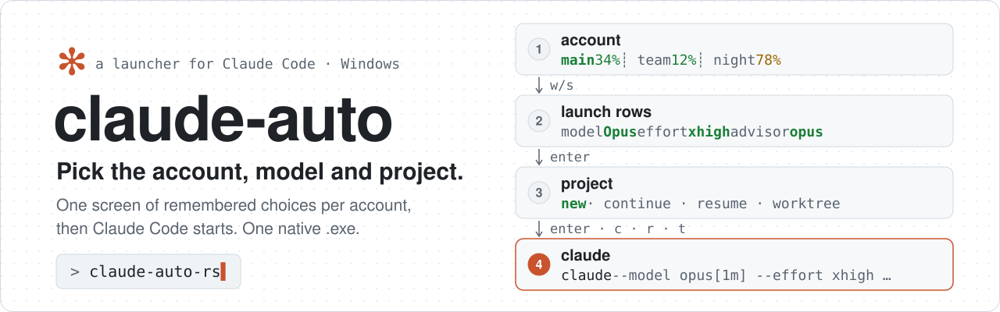
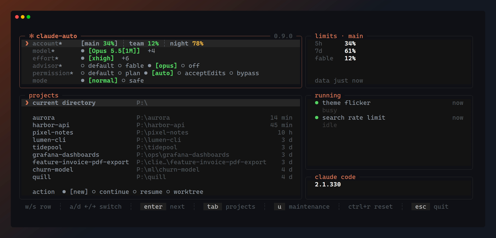
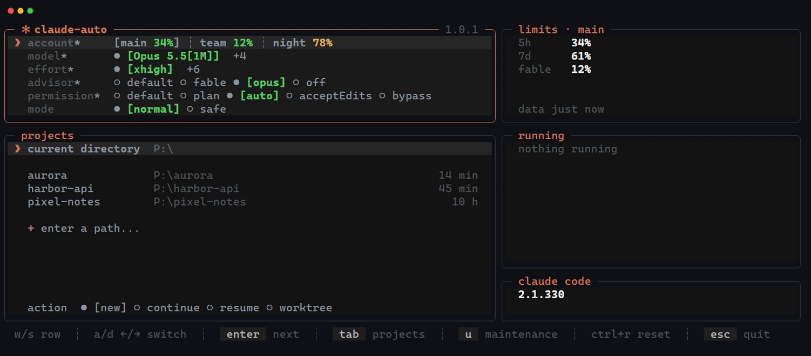
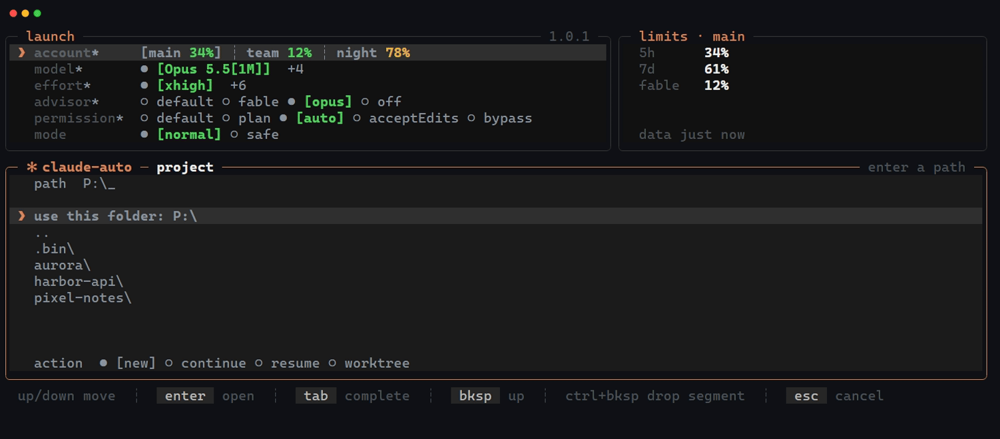
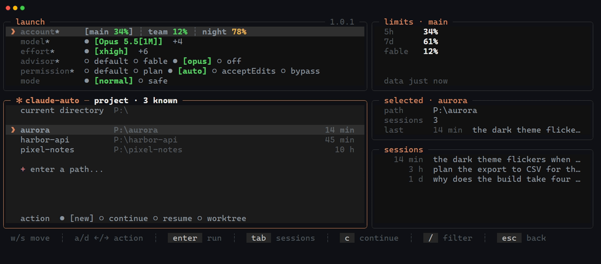

<div align="center">
  <picture>
    <source media="(prefers-color-scheme: dark)" srcset="docs/media/hero-dark.svg">
    
  </picture>

  <p><b>Pick the account, model, effort and project. Then Claude Code starts.</b><br>
  A keyboard-first launcher for Claude Code on Windows: one screen of remembered choices per account, one native <code>.exe</code>.</p>

  <p>
    <a href="https://github.com/vitaliy-shatskiy/claude-auto-launcher/actions/workflows/ci.yml"></a>
    <a href="LICENSE"></a>
    
    
  </p>

  <p><a href="#quick-start">Quick start</a> · <a href="#what-you-get">What you get</a> · <a href="#install">Install</a> · <a href="#updating">Updating</a> · <a href="#usage">Usage</a> · <a href="#screens-and-keys">Keys</a> · <a href="#configuration">Configuration</a> · <a href="#plugins">Plugins</a> · <a href="#troubleshooting">Troubleshooting</a> · <a href="#public-interface">Public interface</a> · <a href="#development">Development</a></p>
</div>

<br>

<p align="center">
  
  <br>
  <sub>The launch screen on three demo accounts: each tab brings back its own choices and shows its five-hour usage once something writes it (see <b>Files it writes</b>).</sub>
</p>

> [!IMPORTANT]
> Unofficial and unaffiliated with Anthropic. It runs the `claude` CLI you already have. Bugs in the
> CLI itself belong [upstream](https://github.com/anthropics/claude-code/issues).

## Quick start

Take the release exe ([Install](#install)), or build it:

```
git clone https://github.com/vitaliy-shatskiy/claude-auto-launcher.git
cd claude-auto-launcher
cargo build --release --locked
```

Copy `target\release\claude-auto.exe` to a folder on your PATH and run `claude-auto`. Check the
[Requirements](#requirements) first. Want your own Claude Code to set it up? Hand it
[docs/setup-with-claude-code.md](docs/setup-with-claude-code.md).

## What you get

<table>
  <tr>
    <td width="50%" valign="top">
      <picture><source media="(prefers-color-scheme: dark)" srcset="docs/media/feature-accounts-dark.svg"></picture><br>
      <b>Several accounts, one launcher</b><br>
      A tab per account, each remembering its own model, effort, advisor and permission. Usage bars appear when your statusline writes them.
    </td>
    <td width="50%" valign="top">
      <picture><source media="(prefers-color-scheme: dark)" srcset="docs/media/feature-rows-dark.svg"></picture><br>
      <b>Honest defaults</b><br>
      <code>default</code> shows what it resolves to in that account's <code>settings.json</code>. Model names come out of the installed <code>claude.exe</code>.
    </td>
  </tr>
  <tr>
    <td valign="top">
      <picture><source media="(prefers-color-scheme: dark)" srcset="docs/media/feature-projects-dark.svg"></picture><br>
      <b>Projects and sessions</b><br>
      Known projects with pins on top, a typed path or a new git worktree. Continue the last session, or resume and fork one from a picker with a chat preview.
    </td>
    <td valign="top">
      <picture><source media="(prefers-color-scheme: dark)" srcset="docs/media/feature-safe-dark.svg"></picture><br>
      <b>Safe mode</b><br>
      One row starts a session without CLAUDE.md, skills, plugins, hooks and MCP.
    </td>
  </tr>
  <tr>
    <td valign="top">
      <picture><source media="(prefers-color-scheme: dark)" srcset="docs/media/feature-sharing-dark.svg"></picture><br>
      <b>Multi-account sharing</b> (opt-in)<br>
      Settings, skills, agents, hooks and projects linked from one account into the others, MCP servers mirrored, repaired on every launch.
    </td>
    <td valign="top">
      <picture><source media="(prefers-color-scheme: dark)" srcset="docs/media/feature-secrets-dark.svg"></picture><br>
      <b>Per-project secrets</b><br>
      Files in a secrets folder become the session's environment variables, so no token sits in a config file.
    </td>
  </tr>
  <tr>
    <td valign="top">
      <picture><source media="(prefers-color-scheme: dark)" srcset="docs/media/feature-hooks-dark.svg"></picture><br>
      <b>Plugins, hooks and a JSON API</b><br>
      Plugins add rows, keys, projects and sessions; scripts run beside each launch. Another program can launch as the screen would.
    </td>
    <td valign="top">
      <picture><source media="(prefers-color-scheme: dark)" srcset="docs/media/feature-keys-dark.svg"></picture><br>
      <b>Keyboard and mouse, one file</b><br>
      Every screen works from the keyboard, and hover, click and the wheel work too. Rust, one <code>.exe</code>, no runtime; it updates itself from its releases.
    </td>
  </tr>
</table>

## Requirements

- Windows 10 or 11, x64. The C runtime is linked in: no VC++ redistributable needed.
- A real console: Windows Terminal, conhost or an IDE terminal. With redirected input there are no
  screens and claude starts on the default account; with no console window a short text prompt
  asks for the account instead.
- Claude Code's native install with `claude` on PATH (`~\.local\bin\claude.exe`). An npm install
  launches, but maintenance `u`, `r` and `p`, the Claude Code update and the model names read out
  of `claude.exe` need the native one; the maintenance screen then says `not a native install`.
  The launch screen is tested against Claude Code `2.1.316`; a much older or newer CLI may accept
  different flags.
- Network, for two separate updates:
  - **Claude Code update**: before every launch screen the launcher asks
    `https://downloads.claude.ai/claude-code-releases/<channel>` (5 s timeout, answer cached 30
    minutes; the channel is `autoUpdatesChannel` in `~/.claude/settings.json`, default `latest`)
    and runs `claude update` when the channel is newer. `CLAUDE_AUTO_NO_UPDATE=1` turns it off.
  - **claude-auto self-update**: once a day, on a background thread,
    `https://api.github.com/repos/<updateRepo>/releases/latest`, and the release's files from
    `github.com` when you update. `selfUpdate: "off"` or `CLAUDE_AUTO_NO_SELF_UPDATE=1` turns it
    off. See [Updating](#updating).
- Sharing (opt-in) only: Developer Mode on (or one elevated run) for the `CLAUDE.md` symlink, and
  every account root on the same drive as `~/.claude` (hardlinks).
- PowerShell 7 (`pwsh`) only for `.ps1` launch hooks and for `maintenanceActions` (always run
  through `pwsh -File`); Node.js only for `.js`/`.mjs` launch hooks.
- Building from source: Rust through `rustup` with the MSVC host toolchain and the Visual Studio C++
  build tools. `rust-toolchain.toml` pins the version and the `clippy` and `rustfmt` components.

## Install

From the [latest release](https://github.com/vitaliy-shatskiy/claude-auto-launcher/releases/latest),
into a folder of your own, hash checked, on the user PATH:

```powershell
$dir = Join-Path $env:LOCALAPPDATA 'Programs\claude-auto'
New-Item -ItemType Directory -Force $dir | Out-Null
$base = 'https://github.com/vitaliy-shatskiy/claude-auto-launcher/releases/latest/download'
Invoke-WebRequest "$base/claude-auto.exe" -OutFile "$dir\claude-auto.exe"
Invoke-WebRequest "$base/claude-auto.exe.sha256" -OutFile "$dir\claude-auto.exe.sha256"
$want = (Get-Content "$dir\claude-auto.exe.sha256" -Raw).Split(' ')[0].Trim()
$have = (Get-FileHash "$dir\claude-auto.exe" -Algorithm SHA256).Hash.ToLower()
if ($have -ne $want) { throw 'hash mismatch: do not run it' }
Unblock-File "$dir\claude-auto.exe"
$userPath = [Environment]::GetEnvironmentVariable('Path', 'User')
if (($userPath -split ';') -notcontains $dir) {
  [Environment]::SetEnvironmentVariable('Path', ((@($userPath -split ';' | Where-Object { $_ }) + $dir) -join ';'), 'User')
}
```

Open a new terminal and run `claude-auto --launcher-version`. Releases also carry a build
attestation: `gh attestation verify claude-auto.exe -R vitaliy-shatskiy/claude-auto-launcher`.
With no config file the launcher runs one `work` account on `~/.claude`.

**From source**: `cargo build --release --locked`, then copy `target\release\claude-auto.exe` to a
folder on your PATH. There is no installer. A build under a `target\` directory never replaces
itself through self-update.

**Cargo features**: the mouse, multi-account sharing, the Remote row and the Rider MCP scan are
cargo features, all on by default (`mouse`, `sharing`, `remote`, `rider-mcp`). Leave any out:
`cargo build --release --locked --no-default-features --features mouse,sharing` builds without the
other two; `--no-default-features` alone builds without all four. A config key of a left-out
module (`mouse`, `sharing`, `remote`, `riderMcp`) warns that the build has no such module and the
module stays off.

## Updating

Two updates, each with its own switch:

| | What it updates | Switch | By hand |
|---|---|---|---|
| **Claude Code update** | the `claude` CLI, before the launch screen | `CLAUDE_AUTO_NO_UPDATE=1` | maintenance `u` (`r` rename swap when a lock keeps the old build) |
| **claude-auto self-update** | this launcher, from its GitHub releases | `selfUpdate`, `CLAUDE_AUTO_NO_SELF_UPDATE=1` | maintenance `c` update, `b` roll back |

claude-auto self-update checks the releases once a day, on a background thread that never holds up
the launch screen. The answer is cached in `~/.claude/claude-auto-self-update.json`. When the
check is offline, rate-limited or gets a malformed answer, nothing is shown and it tries again the
next day. Only a plain `major.minor.patch` release newer than the running one is offered: never a
pre-release, never a downgrade.

- `selfUpdate: "notify"` (the default): the launch screen shows
  `claude-auto <new> available · u → update`; maintenance (`u`) then has `c` update claude-auto
  to `<new>`.
- `selfUpdate: "auto"`: the same download runs in the background, and the launch screen says
  `claude-auto updated to <new> - takes effect next start`. A failed update waits a day before it
  tries that release again; a build you rolled back from comes back only through `c`.
- `selfUpdate: "off"` or `CLAUDE_AUTO_NO_SELF_UPDATE=1`: no check and no network.

An update downloads `claude-auto.exe` and `claude-auto.exe.sha256` of that release over https
only, and checks the hash before it touches anything. On a mismatch the download is deleted and the
installed exe stays as it was. The running exe is renamed to `claude-auto.exe.old` and the new one
takes its name; if that move fails, the old one is put back. The running launcher carries on; the
new version starts next time. Maintenance `b` rolls back to `claude-auto.exe.old`, which then keeps
the current one as `.old`. A fork sets `updateRepo: "owner/name"` to update from its own releases.

By hand: a running launcher holds its exe, so rename it first (`claude-auto.exe` →
`claude-auto.exe.old`), copy the new one in, delete the old one later. Config, prefs and caches
carry over.

## Usage

```
claude-auto                              # the screens, then claude
claude-auto --model opus "fix the build" # no screens: claude on the default account with exactly these arguments
claude-auto --launcher-version           # the launcher's own version
```

With any argument there are no screens: claude starts on the default account (the canonical one,
or the first shown one when it is hidden) with exactly those arguments. The launcher's own
`--launcher-version`, `--launcher-debug` and `--launcher-timings [--days N]` count only as the whole
command line; anywhere else they go to claude too. The launcher has no `--help` of its own:
`claude-auto --help` and `--version` are claude's. `--launcher-options` and `--launcher-run` are
the [headless entries](#headless-entries).

A secondary account's session runs with `CLAUDE_CONFIG_DIR=<its root>`; on the canonical account
(`~/.claude`) the variable is removed from the session. The session carries
`CLAUDE_AUTO_LAUNCHED=1`, so a SessionStart hook can tell a launcher start from one by hand.

## Screens and keys

The screens run in order: launch (account tabs and the launch rows), project, then the session
picker when you resume. `u` on the launch screen opens maintenance.

<p align="center">
  <a href="docs/media/launch-walk.mp4"></a>
  <br>
  <sub>Switching accounts brings back each one's choices, then the model, effort and advisor rows are stepped.</sub>
</p>

| Screen | Keys |
|---|---|
| **Launch** | `w`/`s` or arrows move between rows · `a`/`d` or arrows change the value · `ctrl+r` resets the restored choices · `enter` next (with `projectScreen: "onDemand"`: launch) · `u` maintenance · a plugin's action key · `esc` quit |
| **Project** | `enter` runs the action on the highlighted row · `a`/`d` step the action (`new`, `continue`, `resume`, `worktree`) · `c` continue · `r` resume · `t` new git worktree (`-w`) · `/` filter · `p` pin or unpin the project on top (saved to `pinnedProjects`) · `h` hide or show the project (saved to `hiddenProjects`) · `v` list the hidden projects, marked · `esc` back one step: an open filter, then a kept filter, then the hidden view, then the launch screen |
| **Project filter** (`/`) | type words · `↑`/`↓` move while typing · `←`/`→` the action · `enter` runs the highlighted row (`no project matches` on the current directory when nothing matches) · `esc` clears |
| **Path navigator** (`enter a path...`) | type a path · `↑`/`↓` move · `enter` or `→` enters the folder (on `use this folder`: picks it) · `←` up one folder · `backspace` on an empty segment goes up · `ctrl+backspace` drops a segment · `tab` completes, a second `tab` cycles · `esc` back to the list |
| **Session picker** | `enter` open · `f` fork · `tab` this project or every project · `/` filter · `esc` back |
| **Maintenance** | `u` update Claude Code · `r` rename swap · `d` doctor · `m` mcp list · `p` prune old Claude Code builds · `l` launch rows editor · `c` update claude-auto · `b` roll back claude-auto (`c` and `b` when offered) · one key per `maintenanceActions` entry · `esc` back |
| **Rows editor** (`l`) | `w`/`s` row · `ctrl+w`/`ctrl+s` or `alt+↑`/`alt+↓` move it · `ctrl+x` or `space` hide/show (not `account`) · `a`/`d` or `←`/`→` the value a hidden row launches with · `enter` save to `rows` and `hiddenValues` · `esc` cancel |
| **Mouse** | hover highlights · a click selects a row, a second click on that row runs it · click a footer button to press its key · wheel scrolls |

The footer names the keys of the state you are in. A row the keyboard or the wheel moved to still
takes one click to select it before a click runs it. Plugin action keys are one letter or digit
and never `u w a s d`. In the rows editor a hidden row stays in place, dimmed, and a second click
on its value steps it; with `remote` off the remote entry reads `off in config`. The held-session
warning (another claude holds the session you picked) has `[enter] go on` and `[esc] back`.

### Layout

- Every screen fills the whole terminal from its top-left corner, at any size, and redraws on
  resize. A size report of 0 or over 10000 cells on a side is taken as 80x25 on that side. From
  155 columns the usage bars double to 16 cells.
- From 100 columns the project rows keep compact columns: the name (at most 40 % of the width),
  the path two cells after the longest name, the age right-aligned after the longest path. A path
  that does not fit is cut in the middle with `…`, keeping its drive and leaf.
- Below 100 columns the launch screen collapses only the rows that do not fit to `‹ value ›`.
- The footer names the keys that switch a row: `a/d ←/→ switch` on the launch screen,
  `a/d ←/→ action` on the project screen (`<-/->` in ASCII).
- A screen repaints only the lines that changed, and a burst of input (mouse motion, key repeat)
  costs one frame.
- Box drawing is ASCII when the console is not on UTF-8 or `CLAUDE_AUTO_ASCII=1`.

### Project screen

The project screen lists the current directory first, then pinned projects (a dim `↑` before the
name; a pinned folder that is gone stays, dimmed and marked `(missing)`), then known projects from
`~/.claude/projects` newest first. A project only a secondary account ever ran in, with sharing
off, is not listed. Picking a row checks the folder without waiting on an offline network share; a
file path is refused.

Left out and counted in the title: scratch directories (under the temp folder or an account root's
`jobs\<id>\tmp`), and a project only headless sessions (`claude -p`, the SDKs) ever ran in, a git
root included (`hideHeadlessProjects`). The action opens at `new` every launch.

Search (`/`): space-separated words must all match; a pasted path (`C:\src\x`, a UNC path) matches
as typed. Name starts with a word first, then name contains it, then path; a pin only breaks ties;
hidden projects last; matched text underlined.

The path navigator lists the typed parent's subfolders, filtered by the last segment, and the
drives on an empty field, with a `use this folder` row and a `..` row. Only a full path
(`C:\...`, `\\server\share\`) is listed. Network folders are listed only on `tab` (`no answer in
1000 ms` for a dead share; a later `tab` picks up a late answer). A missing folder whose parent
exists asks `create <path>? enter yes / esc no`: one level, never on a network path; a click or a
cursor move drops the question.

<p align="center">
  <a href="docs/media/navigator-walk.mp4"></a>
  <br>
  <sub>Type or pick a folder in the screen: tab completes, and a missing folder is created only after a yes.</sub>
</p>

### Session picker

A row is the session's title and age (and its project outside one project's view); a green dot
marks a session live now. The title is the session's `/rename` name, else Claude Code's newest AI
title, else its first prompt. The rows show at once; titles and message counts fill in as a
background scan finishes them.

The preview on the right is a chat: the title, `DD.MM HH:MM · N msgs · size`, then the newest
messages from the bottom up, Claude's on the left under an orange `claude · DD.MM HH:MM` label,
yours on the right in cyan. Tool calls, tool results and notifications are left out and markdown
shows as plain text; an older message is cut at 8 lines. It loads off the UI thread once the cursor
rests and says `loading…` until it lands.

With sharing on the picker reads the canonical `<root>\projects`. With sharing off it lists every
account's sessions, the chosen account's own and the others' tagged `[account]`. Resuming a tagged
one first copies its transcript into the chosen account's store: a newer copy there is left alone,
an older one is kept as `<id>.jsonl.<ms>.bak`, and a failed copy stops the launch. Preview copies
nothing. Headless sessions are left out.

<p align="center">
  <a href="docs/media/sessions-walk.mp4"></a>
  <br>
  <sub>Resume from the session picker: the preview shows each past session's last messages before you open it.</sub>
</p>

<details><summary><b>The project screen and the session picker</b> (golden frames from <code>tests/fixtures/wide-frames/</code>, sample data)</summary>

```
╭─ project ─ 4 known ─────────────────────────────────────────────────────────────────────────────╮
│   current directory  C:\Users\sample\here                                                       │
│                                                                                                 │
│ ❯ alpha              C:\Users\sample\Desktop\Projects\alpha                   4 min             │
│   beta-service       C:\Users\sample\Desktop\Projects\workspace\beta-service    8 h             │
│   ⌂ gamma            C:\Users\sample\Desktop\Projects\gamma.worktrees\feature   3 d             │
│   delta              D:\src\delta                                              23 d             │
│                                                                                                 │
│   + enter a path...                                                                             │
│                                                                                                 │
│                                                                                                 │
│                                                                                                 │
│                                                                                                 │
│                                                                                                 │
│                                                                                                 │
│                                                                                                 │
│                                                                                                 │
│                                                                                                 │
│                                                                                                 │
│                                                                                                 │
│                                                                                                 │
│                                                                                                 │
│                                                                                                 │
│                                                                                                 │
│                                                                                                 │
│   action  ● [new] ○ continue ○ resume ○ worktree                                                │
╰─────────────────────────────────────────────────────────────────────────────────────────────────╯
  w/s move    ┊  a/d ←/→ action  ┊  [enter] run  ┊  [c] continue  ┊  [r] resume  ┊  [t] worktree
  [/] filter  ┊  [p] pin         ┊  [h] hide     ┊  [v] hidden    ┊  [esc] back

╭─ resume ─ 5 sessions ───────────────────────────────────────────────────────────────────────────╮
│   project-1  session title 1    7 min │ session title 2                                         │
│ ❯ project-2  session title 2   14 min │ 16.09 11:46 · 20 msgs · 4 KB · project-2                │
│   ⌂ feature  session title 3   21 min │ ─────────────────────────────────────────────────────── │
│   project-4  session title 4   28 min │ claude · 16.09 11:11                                    │
│   project-5  session title 5   35 min │ Plan: read the transcript tail on a                     │
│                                       │ worker thread, then render it.                          │
│                                       │                                                         │
│                                       │                                       you · 16.09 11:12 │
│                                       │                                               ok, do it │
│                                       │                                                         │
│                                       │ claude · 16.09 11:40                                    │
│                                       │ Done. Every step is in the log. Every                   │
│                                       │ step is in the log. Every step is in the                │
│                                       │ log. Every step is in the log. Every step               │
│                                       │ is in the log. Every step is in the log.                │
│                                       │ Every step is in the log. Every step is                 │
│                                       │ in the log. Every step is in the log.                   │
│                                       │ Every step is in the log. Every step is                 │
│                                       │ in the log. Every step is in the log.                   │
│                                       │ Every step is in the log. Every step is                 │
│                                       │ in the log. Every step is in the log.                   │
│                                       │ Every step is in the log. Every step is                 │
│                                       │ in the log. Every step is in the log.                   │
│                                       │ Every step is in the log. Every step is                 │
│                                       │ in the log. The last line of the newest                 │
│                                       │ reply.                                                  │
╰─────────────────────────────────────────────────────────────────────────────────────────────────╯
  w/s move  ┊  [/] filter  ┊  [enter] open  ┊  [f] fork  ┊  [esc] back
```
</details>

## Configuration

`~/.claude/claude-auto.json` (or `CLAUDE_AUTO_CONFIG`). No file = one account, `work` ->
`~/.claude`, sharing and remote off. [`config.example.json`](config.example.json) is a
two-account starting point:

```json
{
  "$schema": "https://raw.githubusercontent.com/vitaliy-shatskiy/claude-auto-launcher/main/schema/claude-auto.schema.json",
  "accounts": [
    { "key": "work", "root": "~/.claude", "label": "work account", "tint": "Green" },
    { "key": "second", "root": "~/.claude-second", "label": "second account", "tint": "Magenta" }
  ],
  "sharing": false,
  "pinnedProjects": ["~/src/my-app"],
  "selfUpdate": "notify"
}
```

Every validation failure falls back to the default for that key and prints a warning at launch.
Nothing throws. An unrecognised top-level key (a typo, e.g. `account` for `accounts`) also warns,
naming it. Windows paths in JSON: write `~/...`, forward slashes, or double every backslash
(`C:\\Users\\me\\.claude`). A single backslash fails the whole file.

[`schema/claude-auto.schema.json`](schema/claude-auto.schema.json) is the JSON Schema of this file
(draft 2020-12): with `"$schema"` at the top an editor completes and checks the keys. The launcher
ignores `$schema`. `version` (default `1`) is the config format; a file with a higher version,
written by a newer claude-auto, is read best-effort with one warning: the keys this launcher knows
apply, the rest warn as unknown.

<details><summary><b>All config keys</b></summary>

| key | type | default | notes |
|---|---|---|---|
| `$schema` | URL | none | the editor's schema; ignored by the launcher |
| `version` | integer | `1` | the config format; higher than the launcher knows = one warning, best-effort read; not a whole number of at least 1 = a warning, read as `1` |
| `accounts[]` | `{key, root, label, tint, hidden, archived}` | one `work` account | see [Accounts](#accounts) below |
| `sharing` | bool | `false` | forced off with fewer than two accounts. Read [Multi-account sharing](#multi-account-sharing) before turning it on |
| `remote` | bool | `false` | keep it off: author setup only, see [Optional author setup](#optional-author-setup) |
| `riderMcp` | `auto`\|`on`\|`off` | `auto` | `auto` scans for Rider's MCP port only while Rider is running |
| `extraMcpConfigs[]` | paths | `["~/.claude/mcp-shared.json"]` | must be absolute. A relative entry is skipped with a warning |
| `secretsRoot` | path | `~/.claude-secrets` | must be absolute. See [Secrets](#secrets) |
| `vsecPath` | path | `""` | author setup only, see [Optional author setup](#optional-author-setup) |
| `launchHooks[]` | paths | `[]` | `.ps1`/`.js`/`.mjs`/`.cmd`, run after the account choice with the chosen project as the working directory, each best-effort. Must be absolute. Entries run at the same time; an entry that is an array of paths runs them in order (`["a.ps1", ["b.ps1", "c.ps1"]]`) |
| `maintenanceActions[]` | `{key, label, script, confirmTwice}` | `[]` | key is one character, a-z or 0-9, outside `u r d m p l c b` (the maintenance screen's own keys). `script` is required and must be absolute. An entry failing either check is skipped with a warning |
| `rows[]` | row names | every row | the launch rows in drawing order: `account`, `remote`, `model`, `effort`, `advisor`, `permission`, `mode`. An unlisted row is hidden and launches with its `hiddenValues` entry, else its default (`mode` = normal), never a remembered choice. `account` is always shown, first when unlisted. `remote` keeps its place here while the `remote` key is off and shows once it is on. Duplicates: the first wins; unknown names are named in one warning. The rows editor (maintenance `l`) writes it |
| `hiddenValues` | object | none | row name -> the value that row launches with while hidden, e.g. `{"effort": "high", "model": "fable"}`: the same claude arguments as picking it on a shown row. Values: [the table below](#row-values); `account` takes none. Saving in the rows editor keeps only hidden rows' entries: a shown row's entry and a bad entry are removed. A hidden row never takes a remembered value, not even from another account tab this run. An unknown row or value warns and is skipped. A model the account lacks falls back as a remembered one does: to `default` |
| `modelOrder[]` | family names | `["haiku","sonnet","opus","fable"]` | the model row after `default`, in this order. An unlisted family is hidden. Unknown names warn |
| `hiddenProjects[]` | paths | `[]` | projects the project screen leaves out. `h` appends the project's path, or removes every entry that expands to it; the other entries stay as written. A save that fails keeps the change for that run and says why. Absolute, case-insensitive; a path that no longer exists is kept. A filter or `v` still finds them |
| `pinnedProjects[]` | paths | `[]` | projects the project screen lists first, in this order, whatever their recency; in a `/` search a pin only breaks ties. `p` appends the project's path, or removes every entry that expands to it. Pinning a hidden project removes it from `hiddenProjects`, hiding a pinned one removes it from here. A pinned folder that no longer exists is kept and listed dimmed, marked `(missing)`. Absolute, case-insensitive |
| `hideHeadlessProjects` | bool | `true` | a project with no interactive session (only `sdk-*` transcripts) is hidden even when it is a git root. `false` keeps a headless git root listed |
| `projectScreen` | `always`\|`onDemand` | `always` | `onDemand`: Enter on the launch screen starts in the launch directory, and an `action` row (`new`, `project`, `continue`, `resume`, `worktree`, never remembered) picks what it does; `project` opens the project screen for that launch, Esc returns |
| `mouse` | bool | `true` | `false` arms no mouse input. `CLAUDE_AUTO_NO_MOUSE=1` turns it off whatever this says |
| `plugins[]` | `{name, path, args, timeoutMs}` | `[]` | the only plugin processes that ever run, see [Plugins](#plugins). `name`: 1-32 letters, digits, `-`, `_`, unique ignoring case. `path`: absolute, never looked up on PATH. `timeoutMs`: 1-120000, overrides every verb's default. A bad entry is skipped with a warning |
| `selfUpdate` | `notify`\|`auto`\|`off` | `notify` | claude-auto self-update, see [Updating](#updating) |
| `updateRepo` | `owner/name` | `vitaliy-shatskiy/claude-auto-launcher` | the GitHub repo whose releases claude-auto self-update uses |

#### Accounts

- `key`: 1-8 characters, unique ignoring case (a shared first letter is fine: the no-UI prompt
  advertises the shortest unique prefix).
- `root`: absolute; exactly one account's root must be `~/.claude` (the canonical account).
- `tint`: Green, Magenta, Cyan, Blue, Yellow or Red. Anything else falls back to Green with a
  warning.
- `hidden`: left out of the tab strip and the no-UI prompt's text, still typeable there.
- `archived`: ignored entirely (no tab, no prompt entry, no relink or junction, no limits, not
  restored from prefs), while its key still counts for uniqueness. On the canonical account it is
  refused with a warning and the account stays live.

Only these discard the WHOLE roster, falling back to the single default `work` account with a
warning naming the culprit: an empty list, a key outside 1-8 characters, a duplicate key, a root
that is not absolute, or not exactly one canonical root.

A new account: pick its tab, start a session, type `/login` once in it.

#### Row values

| Row | Values |
|---|---|
| `model` | `default`, then the families in `modelOrder`: `haiku`, `sonnet1m`, `opus1m`, `fable` |
| `effort` | `default`, `low`, `medium`, `high`, `xhigh`, `max`, `ultracode` |
| `advisor` | `default`, `fable`, `opus`, `off` |
| `permission` | `default`, `plan`, `auto`, `acceptEdits`, `bypass` (= `bypassPermissions`) |
| `mode` | `normal`, `safe` |
| `remote` | `on`, `off` (author setup only) |

</details>

## Plugins

A plugin is a program you list in config `plugins`; nothing in a folder runs by itself, and a
listed path that is missing is skipped, never looked up elsewhere. The launcher starts it as
`<path> <args...> <verb>`, windowless, writes one JSON line to its stdin and reads one JSON value
from its stdout. A crash (non-zero exit), a timeout or bad JSON prints one warning and skips that
plugin's part; the launch goes on. A timed-out plugin is killed with every process it started; a
call that ends on its own leaves what it opened running. Only an explicit `cancel` from
`preLaunch` stops a launch. Preview and `--launcher-options` start no plugin: they use the cached
`describe` answers only.

```json
"plugins": [{ "name": "sample", "path": "~/tools/plugin_sample.exe", "args": [], "timeoutMs": 3000 }]
```

Protocol 1. Every request carries `"protocol": 1` beside the fields below. Protocol 1 may gain
optional fields in a later launcher: a plugin must ignore a field it does not know, and the
launcher ignores unknown fields in a plugin's answers. A plugin may answer `describe` with a higher
`protocol`; the launcher then uses only the protocol 1 fields and warns once.

| verb | stdin | stdout | timeout |
|---|---|---|---|
| `describe` | `{}` | `{protocol: 1, rows: [{name, label, values, default}], actions: [{key, label, screen}], hooks: ["preLaunch", "postLaunch"], sources: ["projects", "sessions"]}` | 2 s |
| `preLaunch` | `{choice}` | `{env?: {NAME: value}, args?: [...], cancel?: "reason"}` | 10 s |
| `postLaunch` | `{choice, exitCode}` | any object (ignored) | 10 s |
| `action` | `{key, context: {screen, cwd}}` | `{message?}` (printed after the screens) | 10 s |
| `projects` | `{}` | `[{path, name?, lastUsed?}]` | 2 s |
| `sessions` | `{project}` (`""` = every project) | `[{id, title?, updated?}]` | 2 s |

- `describe` is cached in `claude-auto-plugins.json` beside the config, per path, and asked again
  when the file's size or write time or the entry's `args` change.
- Limits: the first 8 `rows` and 8 `actions` of a plugin are read, the rest ignored. A row with no
  values or more than 32, a value over 64 characters or a duplicate name is skipped with a
  warning; a label over 64 characters falls back to the row's name.
- `rows` sit after the built-in rows on the launch screen; `default` must be one of `values` (no
  default = the first). A row's value is never remembered. The headless entries name them
  `<plugin>.<row>` under `pluginRows`.
- `choice`: `account`, `project`, `action`, `model`, `effort`, `advisor`, `permission`, `mode`,
  `resumeId` and `rows` - the plugin's own rows only.
- `preLaunch`: `env` names may not hold `=` or a control character, values and `args` no NUL (at
  most 64 variables of 8 KiB, 32 arguments of 4 KiB); one bad entry refuses the plugin's whole
  answer with a warning. Plugins run at once; their variables and arguments apply in config order.
  `preLaunch` may not set the account or its credentials: `CLAUDE_CONFIG_DIR`,
  `CLAUDE_CODE_OAUTH_TOKEN`, a `CLAUDE_CODE_USE_*` provider switch, `USERPROFILE`, `HOME` or any
  `ANTHROPIC_*` variable refuses the answer with a warning.
- `actions`: one letter or digit. In protocol 1 actions sit only on the `launch` screen (any other
  `screen` is refused with a warning), whose own keys `u w a s d` are refused too, as is a key an
  earlier plugin took.
- `projects` entries join the project screen as `name [plugin]`; a directory the launcher already
  knows keeps its own row. Resume on a plugin-only project lists the sessions Claude stored for
  that directory, or none - never every session. `sessions` entries join the resume picker tagged
  `[plugin]` and resume with `claude --resume <id>` (an id is letters, digits, `-`, `_`, not
  starting with `-`, at most 128 characters).
- `hooks` and sources run only when the screens or the launch need them, not in preview.

[`examples/plugin_sample.rs`](examples/plugin_sample.rs) is the reference plugin: a `ticket` row
whose value reaches claude as `SAMPLE_TICKET`, a `j` action, empty sources. `cargo build --example
plugin_sample`, then list `target/debug/examples/plugin_sample.exe` by its full path.
[`examples/plugin_git_branch.rs`](examples/plugin_git_branch.rs) is a useful one: `preLaunch`
sets `CLAUDE_AUTO_GIT_BRANCH` to the launch directory's branch (read from `.git/HEAD`, no git
process), and `g` on the launch screen shows the branch and the `git status --porcelain` count.

## Secrets

`secretsRoot` (default `~/.claude-secrets`) is a directory of per-project subdirectories whose
files become environment variables of the launched session: file name = variable name, content =
value. `shared/` applies first, then `<slug>/` for the chosen project overrides it. `.md` files and
empty files are skipped. When it found anything the launcher prints `secrets from files (vsec not
found)`. Values are never printed.

Refused names: anything that is no valid variable name, names the system owns (`PATH`, `TEMP`,
`USERPROFILE`, ...), Claude Code's own auth (`ANTHROPIC_API_KEY`, `ANTHROPIC_AUTH_TOKEN`,
`CLAUDE_CODE_OAUTH_TOKEN`, `ANTHROPIC_BASE_URL`: the session keeps the account's login) and the
secrets store's key `BWS_ACCESS_TOKEN`.

## Multi-account sharing

`sharing: true` (two or more accounts, off by default) hardlinks `settings.json` and
`statusline.js`, symlinks `CLAUDE.md`, and junctions `projects`, `plugins`, `hooks`, `agents`,
`skills`, `output-styles`, `rules`, `sessions`, `file-history`, `session-env`, `tasks` and
`shell-snapshots` from every secondary account's root back to the canonical (`~/.claude`) one,
repaired on every launch.

> [!WARNING]
> Read this before you turn sharing on.
> - The repair links from whichever copy is NEWEST anywhere, so a newer secondary copy can REPLACE
>   the canonical one. The losing copy survives as `<file>.pre-relink`, the three before it as
>   `<file>.pre-relink.<yyyyMMdd-HHmmss>`. A `CLAUDE.md` copy equal to the canonical one is
>   replaced and saved as `CLAUDE.md.pre-symlink.<yyyyMMdd-HHmmss>`.
> - Enabling it CREATES every secondary account's root directory on the next launch.
> - Each junction it creates gets an `icacls` deny-delete ACE (`(DE)`, set with `/L` on the link
>   itself), and the secondary account's root one deny-delete-child ACE (`(DC)`), so Claude Code
>   cannot delete the link. Removing a junction later needs `icacls <junction> /L /remove:d
>   "<DOMAIN\user>"` and `icacls <root> /remove:d "<DOMAIN\user>"` first.
> - The MCP mirror copies user- and project-scoped server definitions from the canonical account
>   into the others verbatim, secrets included (a server's `env` and `headers`).
>   `CLAUDE_AUTO_MIRROR_SECRETS=0` copies servers without those two fields and keeps the target's
>   own. `CLAUDE_AUTO_MIRROR_EXCLUDE=name1,name2` never touches those servers.

The canonical definition wins in both MCP scopes: a missing server is added, one defined differently
is replaced, a server only the target has is kept. The mirror is built into the launcher: no Node
needed.

## Headless entries

Two screenless entries let another program (a phone bridge, a script) launch as the screen would.
Each counts only as the first argument.

- `claude-auto --launcher-options` prints one line of JSON: `launcher`, `version` (the newest
  downloaded Claude Code build), `actions`, `rows` (each shown row with its values and labels,
  without `account` and `remote`), `pluginRows` (each plugin row's `name` as `<plugin>.<row>`, `label`, `values`, `default`),
  and `accounts`: per shown account its `key`, `label`, `tint`, `configDir`, `default`,
  `limitPct`, `hidden` values, `defaultLabels` and remembered `prefs`. It starts no process,
  touches no network and writes nothing, not even a log.
- `claude-auto --launcher-run '<json>'` takes `{"account", "project", "action", <every row
  --launcher-options listed>, "pluginRows"?: {"<plugin>.<row>": "<value>"}, "resumeId"?,
  "fork"?}`, checks it against the rows as the screen would offer them on that account, and
  launches. A request with a missing, extra or unoffered value, a missing project folder, or
  `resume` without a `resumeId` exits `2` before anything is written, logged or started (no
  plugin runs either). The choices last for that launch: the remembered rows are not saved.

## Preview, debug and diagnostics

### Preview mode

Preview mode drives the screens from a key script and prints the command it would run. Nothing is
launched and nothing is written outside one projects cache in `%TEMP%`: no update check, no
sharing repair, no hooks, no plugins, no secrets, and maintenance actions answer
`preview - nothing was run`. A `claude` must still resolve on PATH (an empty `claude.cmd` in a PATH
folder will do). Point every file it reads at throwaway copies:

```powershell
$t = Join-Path $env:TEMP 'claude-auto-demo'
New-Item -ItemType Directory -Force (Join-Path $t '.claude') | Out-Null
$env:USERPROFILE = $t
$env:CLAUDE_AUTO_PREFS = Join-Path $t 'prefs.json'
$env:CLAUDE_AUTO_PROJECTS_ROOT = Join-Path $t 'projects'
$env:CLAUDE_AUTO_CONFIG = (Resolve-Path docs\media\demo-config.json).Path
$env:CLAUDE_AUTO_PREVIEW = '1'
$env:CLAUDE_AUTO_PREVIEW_KEYS = 'Enter,Enter'
$env:CLAUDE_AUTO_PREVIEW_SIZE = '100x30'
.\target\release\claude-auto.exe
```

It prints each frame, then a summary ending in `--- preview, nothing launched ---` with the launch
arguments and the command line. A run that ends with `claude-auto: scripted keys exhausted` and
exit 1 ran out of keys before a launch or a quit.

### Debug mode

`claude-auto --launcher-debug` (the only argument) or `CLAUDE_AUTO_DEBUG=1` times each step of
the run. `--debug` stays claude's own flag and passes through.

- Nothing changes on screen. `CLAUDE_AUTO_DEBUG=footer` adds one dim bottom line:
  `load <n> ms · paint <n> ms · last key->frame <n> ms`. The screen then draws one row shorter, so
  nothing is covered.
- F12 opens the timings of this run as a tree, slowest first within each level. Esc goes back.
- Each span lands in the run log as a `timing` record (`name`, `parent`, `ms`, `startMs`). Per
  screen: `<screen>.key`, `<screen>.frame.build` and `<screen>.frame.write` (with its `bytes`);
  the picker's chat load is `picker.chat.load` (with the bytes read).
- `claude-auto --launcher-timings [--days N]` prints count, p50, p95 and max per span name from
  the logs of today (or the last `N` days), then exits.

Off, nothing changes and nothing extra is read or written.

<details><summary><b>Environment switches</b></summary>

| Variable | Effect |
|---|---|
| `CLAUDE_AUTO_CONFIG` | path to the config file, instead of `~/.claude/claude-auto.json` |
| `CLAUDE_AUTO_PREFS` | path to the remembered-choices file, instead of `~/.claude/claude-auto-prefs.json` |
| `CLAUDE_AUTO_NO_MOUSE=1` | never arms mouse input |
| `CLAUDE_AUTO_NO_UPDATE=1` | skips the Claude Code update: the release-channel check and the `claude update` it would run before the launch screen |
| `CLAUDE_AUTO_NO_SELF_UPDATE=1` | skips claude-auto self-update, as `selfUpdate: "off"` does |
| `CLAUDE_AUTO_INPUT_TRACE=1` | logs every raw input record to `~/.claude/claude-auto-logs/input-<date>-<pid>.log` |
| `CLAUDE_AUTO_ASCII=1` | forces ASCII box drawing (otherwise auto-detected from the console code page) |
| `CLAUDE_AUTO_PREVIEW=1` | drives the whole UI and prints the `claude` command it would run, without running it |
| `CLAUDE_AUTO_PREVIEW_KEYS` | a key script for a preview run, e.g. `Enter,r,Enter` |
| `CLAUDE_AUTO_PREVIEW_SIZE` | the preview's terminal size, e.g. `100x30` (default `78x24`) |
| `CLAUDE_AUTO_PROJECTS_ROOT` | the projects directory the project screen and the picker read, instead of `~/.claude/projects` (a test seam) |
| `CLAUDE_AUTO_RATE_LIMITS_DIR` | where the usage records are read, instead of `~/.claude/rate-limits` (a test seam) |
| `CLAUDE_AUTO_DEBUG=1` | debug mode, see above. `footer` adds a timing line under the screen |
| `CLAUDE_AUTO_VSEC` | path to the `vsec` tool, see [Optional author setup](#optional-author-setup) |
| `CLAUDE_AUTO_MIRROR_EXCLUDE`, `CLAUDE_AUTO_MIRROR_SECRETS=0` | the MCP mirror's exclude list and credential opt-out (see [Multi-account sharing](#multi-account-sharing)) |
| `CLAUDE_NO_ROAM=1`, `CLAUDE_REMOTE_ROOT` | author setup only, see [Optional author setup](#optional-author-setup) |
| `NO_COLOR`, `TERM=dumb` | disable colour output |

The launcher sets `CLAUDE_AUTO_LAUNCHED=1` on the session it starts.

</details>

<details><summary><b>Files it writes</b></summary>

- `~/.claude/claude-auto.json` (or `CLAUDE_AUTO_CONFIG`) - the config itself: the rows editor saves
  `rows` and `hiddenValues`, `h` saves `hiddenProjects`, `p` saves `pinnedProjects`. Every other
  key is kept; a file that is not UTF-8 JSON, or whose file attributes cannot be read, is refused,
  never rewritten.
- `~/.claude/claude-auto-prefs.json` - remembered account, model, effort, advisor, permission and
  remote choices.
- `claude-auto-plugins.json` beside the config - the plugins' cached `describe` answers.
- `~/.claude/launcher-logs/*.jsonl` - one file per day, 14-day retention. Records each launch: the
  working directory, the launcher's own argument vector, the launcher version (`psVersion`, a name
  kept from the PowerShell launcher, which reads `rust <version>`), the terminal it came out of,
  and the choices made. **A prompt passed positionally (`claude-auto "fix the build"`) lands there
  in plain text.** Local only, nothing is sent anywhere.
- `~/.claude/claude-auto-logs/input-<date>-<pid>.log` - raw input records, only with
  `CLAUDE_AUTO_INPUT_TRACE=1`.
- `~/.claude/claude-auto-hash-cache.json` - the maintenance screen's version-check cache.
- `~/.claude/claude-auto-models.json` - the model catalog read out of `claude.exe`, keyed on the
  binary's path, size and mtime.
- `~/.claude/claude-auto-update.json` - the Claude Code release channel's last answer (30 minutes,
  a failure 5).
- `~/.claude/claude-auto-self-update.json` - claude-auto self-update's last check and what its
  last update or roll back left.
- `~/.claude/claude-auto-projects.json` - the project screen's registry cache.
- `~/.claude/claude-auto-sessions.json` - the session picker's summary cache (0.9.0 renamed it from
  `claude-auto-rs-sessions.json` and removes the old file on its first write).
- Beside `claude-auto.exe`: `claude-auto.exe.old` (the build before the last self-update or roll
  back) and, while a download runs, `claude-auto.exe.<pid>-<id>.new` (a left-over one is deleted
  an hour after its process is gone).
- `%TEMP%\claude-mcp-rider-<pid>.json` - per-launch Rider MCP config, swept after a day.
- `%TEMP%\claude-auto-projects-preview-<pid>.json` - the project cache of a preview run, swept after
  a day.
- `%TEMP%\claude-rider-mcp-port.txt` - cached Rider MCP port, so most launches skip the port scan.
- `%TEMP%\claude-remote-server-<pid>.log` (plus `.err`, `.build`) - the companion server's output,
  one set per launcher that started it (`remote: true` only), not swept.
- `<file>.pre-relink` and its dated copies beside a shared file a sharing repair replaced.

The launch screen's usage bars read `~/.claude/rate-limits/<key>.json`
(`{"fiveHour": 34, "sevenDay": 61, "atMs": <epoch ms>}`). Nothing in this repo writes that file:
without a writer of your own (a statusline script, say) the bars stay empty.

</details>

### Troubleshooting

**`claude-auto` is not recognised.** A PATH change reaches only a *new* terminal. Open one.

**The maintenance screen says a Claude Code update succeeded and the version did not change.** On
Windows `claude update` can report success while the running binary is untouched, usually a file
lock on the in-use executable. That is what `r` (rename swap) is for: it renames the running binary
aside and installs the new build in its place.

**The whole roster collapsed to one `work` account.** One of the rules under [Accounts](#accounts)
broke: the warning at launch names the culprit and its value. The usual cause is a Windows path in
JSON: `"C:\Users\me\.claude"` is invalid JSON escaping.

**The box drawing is mojibake.** Set `CLAUDE_AUTO_ASCII=1`, or switch the console to UTF-8.

**Arrows or the mouse behave oddly in an embedded terminal.** Some terminals (Rider's, for one) send
mouse reports as VT text rather than as console records. The launcher decodes them, but if it goes
wrong, `CLAUDE_AUTO_NO_MOUSE=1` disables mouse input and `CLAUDE_AUTO_INPUT_TRACE=1` logs every raw
input record for a bug report.

**The launch screen offers a claude-auto update that keeps failing.** With `selfUpdate: "auto"` the
line repeats the reason and the next try waits a day; maintenance `c` tries at once.

### Uninstall

Nothing is installed outside your own user folder, and there is no uninstaller.

1. Delete `claude-auto.exe` (and `claude-auto.exe.old`), or remove the folder you added to PATH.
2. Delete the clone, if you built from source.
3. Optional, to remove the state too: the `claude-auto-*.json` files, `launcher-logs/` and
   `claude-auto-logs/` under `~/.claude` (full list under **Files it writes**).
4. **Only if you ever set `sharing: true`**: lift the deny ACEs, then remove the junctions. Per
   junction `icacls <junction> /L /remove:d "<DOMAIN\user>"`, per secondary root
   `icacls <root> /remove:d "<DOMAIN\user>"` (`whoami` prints `<DOMAIN\user>`).

## Public interface

What scripts, plugins and other tools may build on. No compatibility promise: a change to any of
them is named in the [CHANGELOG](CHANGELOG.md).

- **Config keys** and their meaning, as [`schema/claude-auto.schema.json`](schema/claude-auto.schema.json)
  describes them. New optional keys may appear; `version` names the format.
- **Plugin protocol 1** ([Plugins](#plugins)): the verbs, their requests and answers. It may gain
  optional fields; a plugin ignores fields it does not know, and the launcher ignores unknown
  fields in an answer.
- **CLI flags**: `--launcher-options` and `--launcher-run` with their JSON
  ([Headless entries](#headless-entries)), `--launcher-version`, and every other argument passed
  to claude untouched.
- **Environment switches**: the `CLAUDE_AUTO_*` variables in the table above, and
  `CLAUDE_AUTO_LAUNCHED=1` on the session.

Everything else is internal and may change in any release: the screens, their layout and keys,
cache and state files, log records, `--launcher-debug` and `--launcher-timings` output.

## Optional author setup

The author's own machine has three pieces that are not part of this repo and not published. The
launcher works fully without them: leave their keys at the defaults.

- **`vsec`**, a private secrets tool. Found through config `vsecPath`, env `CLAUDE_AUTO_VSEC`, or
  `vsec.exe`/`vsec.cmd` on PATH, it replaces the `secretsRoot` walk: the launcher runs
  `vsec launch-env --cwd <project>` windowless and sets the variables it returns (JSON
  `{vars:[{name,value}], loaded, notes}`). If vsec is found but fails, the session starts with no
  secrets and one yellow line saying why; the files are not read then.
- **The `<slug>/org/` secrets tier**: a junction at `secretsRoot\<slug>\org`, read between
  `shared/` and `<slug>/`. Never created automatically.
- **`remote: true`**: routes a session through an unpublished companion (`crc.cmd` on PATH plus a
  `remote-control-claude-code` checkout found through `CLAUDE_REMOTE_ROOT`). It adds a Remote row to
  the launch screen and a second prompt to the no-UI fallback. `CLAUDE_NO_ROAM=1` keeps a session
  off it even with `remote: true`.

## Development

```
cargo build --release --locked
cargo fmt --all --check
cargo clippy --all-targets --locked -- -D warnings
cargo test --locked
cargo clippy --no-default-features --all-targets --locked -- -D warnings
cargo test --no-default-features --locked
```

- Toolchain pinned in `rust-toolchain.toml`, edition 2024. One package (`claude-auto-rs`): a
  library (`src/lib.rs`) and the binary `claude-auto` (`src/main.rs`).
- Lints in `Cargo.toml` `[lints]`: clippy pedantic, `unwrap`/`expect` denied, `unsafe_code` denied
  outside the FFI modules. A local override is `#[expect(lint, reason = "...")]`, never `#[allow]`.
- Unit tests sit beside the code (`src/<module>/tests.rs`). Screen tests compare frames against the
  golden files in `tests/fixtures/wide-frames/`. `tests/it/` runs the built binary end to end
  against a fake home and a fake `claude`. `tests/perf` holds the speed budget
  ([perf/README.md](perf/README.md)).
- [CONTRIBUTING.md](CONTRIBUTING.md) has the module map, the privacy scan and `cargo deny`.
- CI (`.github/workflows/ci.yml`, a Windows runner) runs fmt, clippy and test, all `--locked`, then
  clippy and test again with `--no-default-features`.
- Releases: `.github/workflows/release.yml`, run by hand for an existing tag, builds the exe with the
  C runtime linked in (`.cargo/config.toml`), publishes it with its `.sha256` and a build
  attestation, and takes the release notes from that version's `CHANGELOG.md` section.
- The images in this README are drawn by scripts in [docs/media](docs/media/README.md).

[CONTRIBUTING.md](CONTRIBUTING.md) · [SECURITY.md](SECURITY.md) · [CHANGELOG.md](CHANGELOG.md) · [MIT](LICENSE)
