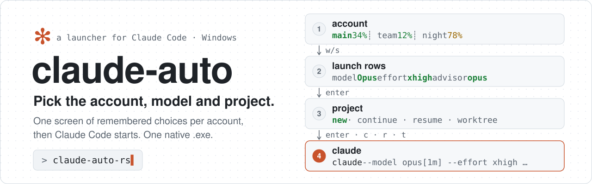
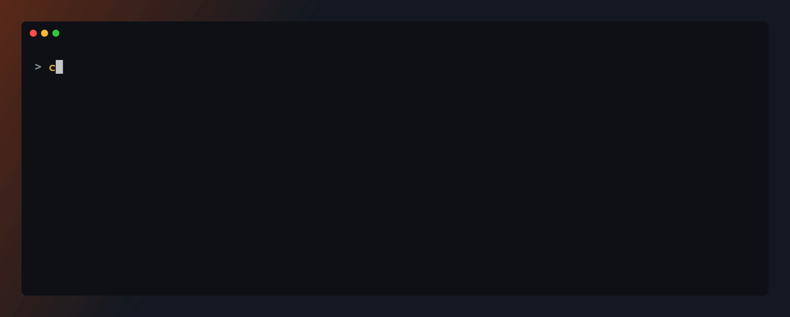
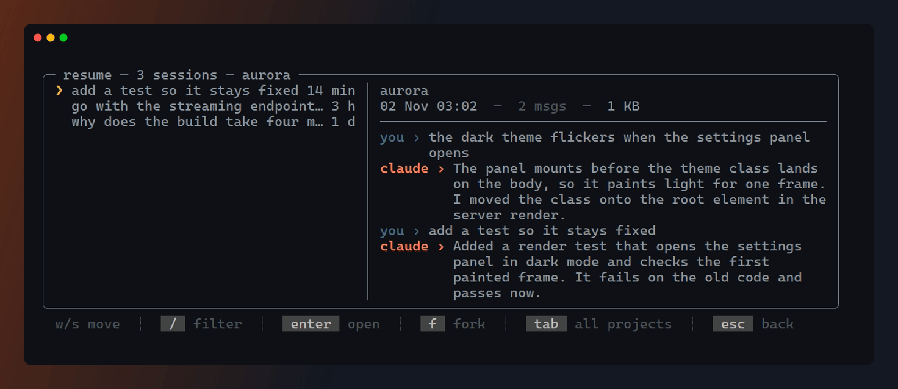

<div align="center">
  <picture>
    <source media="(prefers-color-scheme: dark)" srcset="docs/media/hero-dark.svg">
    
  </picture>

  <p><b>Pick the account, model, effort and project. Then Claude Code starts.</b><br>
  A keyboard-first launcher for Claude Code on Windows: one screen of remembered choices per account, one native <code>.exe</code>.</p>

  <p>
    <a href="https://github.com/vitaliy-shatskiy/claude-auto-launcher/actions/workflows/ci.yml"></a>
    <a href="LICENSE"></a>
    
    
  </p>

  <p><a href="#quick-start">Quick start</a> · <a href="#what-you-get">What you get</a> · <a href="#requirements">Requirements</a> · <a href="#usage">Usage</a> · <a href="#configuration">Configuration</a> · <a href="#development">Development</a></p>
</div>

<br>

<p align="center">
  
  <br>
  <sub>The launch screen on three demo accounts: each tab brings back its own choices and shows its five-hour usage once something writes it (see <b>Files it writes</b>).</sub>
</p>

> [!IMPORTANT]
> Unofficial and unaffiliated with Anthropic. It runs the `claude` CLI you already have. Bugs in the
> CLI itself belong [upstream](https://github.com/anthropics/claude-code/issues).

## Quick start

```
git clone https://github.com/vitaliy-shatskiy/claude-auto-launcher.git
cd claude-auto-launcher
cargo build --release --locked
```

Copy `target\release\claude-auto.exe` to a folder on your PATH and run `claude-auto`. Or take the
release exe: [Install](#install). [Requirements](#requirements) first. Want your own Claude Code to
set it up? Hand it [docs/setup-with-claude-code.md](docs/setup-with-claude-code.md).

## What you get

<table>
  <tr>
    <td width="50%" valign="top">
      <picture><source media="(prefers-color-scheme: dark)" srcset="docs/media/feature-accounts-dark.svg"></picture><br>
      <b>Several accounts, one launcher</b><br>
      A tab per account, each remembering its own model, effort, advisor and permission. Usage bars appear when your statusline writes them.
    </td>
    <td width="50%" valign="top">
      <picture><source media="(prefers-color-scheme: dark)" srcset="docs/media/feature-rows-dark.svg"></picture><br>
      <b>Honest defaults</b><br>
      <code>default</code> shows what it resolves to in that account's <code>settings.json</code>. Model names come out of the installed <code>claude.exe</code>.
    </td>
  </tr>
  <tr>
    <td valign="top">
      <picture><source media="(prefers-color-scheme: dark)" srcset="docs/media/feature-projects-dark.svg"></picture><br>
      <b>Projects and sessions</b><br>
      Known projects, a typed path or a new git worktree. Continue the last session, or resume and fork one from a picker with a preview.
    </td>
    <td valign="top">
      <picture><source media="(prefers-color-scheme: dark)" srcset="docs/media/feature-safe-dark.svg"></picture><br>
      <b>Safe mode</b><br>
      One row starts a session without CLAUDE.md, skills, plugins, hooks and MCP.
    </td>
  </tr>
  <tr>
    <td valign="top">
      <picture><source media="(prefers-color-scheme: dark)" srcset="docs/media/feature-sharing-dark.svg"></picture><br>
      <b>Multi-account sharing</b> (opt-in)<br>
      Settings, skills, agents, hooks and projects linked from one account into the others, MCP servers mirrored, repaired on every launch.
    </td>
    <td valign="top">
      <picture><source media="(prefers-color-scheme: dark)" srcset="docs/media/feature-secrets-dark.svg"></picture><br>
      <b>Per-project secrets</b><br>
      Files in a secrets folder become the session's environment variables, so no token sits in a config file.
    </td>
  </tr>
  <tr>
    <td valign="top">
      <picture><source media="(prefers-color-scheme: dark)" srcset="docs/media/feature-hooks-dark.svg"></picture><br>
      <b>Launch hooks and maintenance</b><br>
      Scripts run beside each launch. A maintenance screen for update, doctor, MCP list and your own actions.
    </td>
    <td valign="top">
      <picture><source media="(prefers-color-scheme: dark)" srcset="docs/media/feature-keys-dark.svg"></picture><br>
      <b>Keyboard and mouse, one file</b><br>
      Every screen works from the keyboard, and hover, click and the wheel work too. Rust, one <code>.exe</code>, no runtime.
    </td>
  </tr>
</table>

## Requirements

- Windows 10 or 11, x64. The C runtime is linked in: no VC++ redistributable needed.
- A real console: Windows Terminal, conhost or an IDE terminal. With redirected input there are no
  screens and claude starts on the default account; with no console window a short text prompt
  asks for the account instead.
- Claude Code's native install with `claude` on PATH (`~\.local\bin\claude.exe`). An npm install
  launches, but maintenance `u` update, `r` rename swap, `p` prune, the automatic update and the
  model names read out of `claude.exe` need the native one; the maintenance screen then says
  `not a native install`.
- Network for the automatic update: before every launch screen the launcher asks
  `https://downloads.claude.ai/claude-code-releases/<channel>` (5 s timeout, answer cached 30
  minutes; the channel is `autoUpdatesChannel` in `~/.claude/settings.json`, default `latest`) and
  runs `claude update` when the channel is newer. `CLAUDE_AUTO_NO_UPDATE=1` turns it off.
- Sharing (opt-in) only: Developer Mode on (or one elevated run) for the `CLAUDE.md` symlink, and
  every account root on the same drive as `~/.claude` (hardlinks).
- PowerShell 7 (`pwsh`) only for `.ps1` launch hooks and for `maintenanceActions` (always run
  through `pwsh -File`); Node.js only for `.js`/`.mjs` launch hooks.
- Building from source: Rust through `rustup` with the MSVC host toolchain and the Visual Studio C++
  build tools. `rust-toolchain.toml` pins the version and the `clippy` and `rustfmt` components.

A secondary account's session runs with `CLAUDE_CONFIG_DIR=<its root>`; on the canonical account
(`~/.claude`) the variable is removed from the session.

## Install

From the [latest release](https://github.com/vitaliy-shatskiy/claude-auto-launcher/releases/latest),
into a folder of your own, hash checked, on the user PATH:

```powershell
$dir = Join-Path $env:LOCALAPPDATA 'Programs\claude-auto'
New-Item -ItemType Directory -Force $dir | Out-Null
$base = 'https://github.com/vitaliy-shatskiy/claude-auto-launcher/releases/latest/download'
Invoke-WebRequest "$base/claude-auto.exe" -OutFile "$dir\claude-auto.exe"
Invoke-WebRequest "$base/claude-auto.exe.sha256" -OutFile "$dir\claude-auto.exe.sha256"
$want = (Get-Content "$dir\claude-auto.exe.sha256" -Raw).Split(' ')[0].Trim()
$have = (Get-FileHash "$dir\claude-auto.exe" -Algorithm SHA256).Hash.ToLower()
if ($have -ne $want) { throw 'hash mismatch: do not run it' }
Unblock-File "$dir\claude-auto.exe"
$userPath = [Environment]::GetEnvironmentVariable('Path', 'User')
if (($userPath -split ';') -notcontains $dir) {
  [Environment]::SetEnvironmentVariable('Path', ((@($userPath -split ';' | Where-Object { $_ }) + $dir) -join ';'), 'User')
}
```

Open a new terminal and run `claude-auto --launcher-version`. Releases also carry a build
attestation: `gh attestation verify claude-auto.exe -R vitaliy-shatskiy/claude-auto-launcher`.

From source: `cargo build --release --locked`, then copy `target\release\claude-auto.exe` to a
folder on your PATH. There is no installer.

A second account: pick its tab, start a session, type `/login` once in it.

To update, replace the file. A running launcher holds it: rename the old one first
(`claude-auto.exe` → `claude-auto.old.exe`), copy the new one in, delete the old one later. From
0.5.0 or older (`install.ps1` put the clone folder on the user PATH): remove the clone from PATH, or
leave it and copy `claude-auto.exe` into it. Config, prefs and caches carry over. With no config file the launcher runs one `work` account on `~/.claude`.

The launch screen is tested against Claude Code `2.1.316`. A much older or newer CLI may accept
different flags.

## Usage

```
claude-auto                              # the screens, then claude
claude-auto --model opus "fix the build" # no screens: claude on the default account with exactly these arguments
claude-auto --launcher-version           # the launcher's own version
```

With any argument there are no screens: claude starts on the default account (the canonical one,
or the first shown one when it is hidden) with exactly those arguments. The launcher's own
`--launcher-version`, `--launcher-debug` and `--launcher-timings [--days N]` count only as the whole
command line; anywhere else they go to claude too. The launcher has no `--help` of its own:
`claude-auto --help` and `--version` are claude's.

### Keys

<p align="center">
  <a href="docs/media/launch-walk.mp4"></a>
  <br>
  <sub>Switching accounts brings back each one's choices, then the model, effort and advisor rows are stepped.</sub>
</p>

| Screen | Keys |
|---|---|
| **Launch** | `w`/`s` or arrows move between rows · `a`/`d` or arrows change the value · `ctrl+r` resets the restored choices · `enter` next (with `projectScreen: "onDemand"`: launch) · `u` maintenance · `esc` quit |
| **Project** | `enter` runs the action on the highlighted row · `a`/`d` step the action (`new`, `continue`, `resume`, `worktree`) · `c` continue · `r` resume · `t` new git worktree (`-w`) · `/` filter · `h` hide or show the project (saved to `hiddenProjects`) · `v` list the hidden projects, marked · `esc` back one step |
| **Project filter** (`/`) | type words · `↑`/`↓` move while typing · `←`/`→` the action · `enter` runs the highlighted row (`no project matches` when none) · `esc` clears |
| **Path navigator** (`enter a path...`) | type a path · `↑`/`↓` move · `enter` or `→` enters the folder (on `use this folder`: picks it) · `←` up one folder · `backspace` on an empty segment goes up · `ctrl+backspace` drops a segment · `tab` completes, a second `tab` cycles · `esc` back to the list |
| **Session picker** | `enter` open · `f` fork · `tab` this project or every project · `/` filter · `esc` back |
| **Maintenance** | `u` update · `r` rename swap · `d` doctor · `m` mcp list · `p` prune · `l` launch rows editor · one key per `maintenanceActions` entry · `esc` back |
| **Rows editor** (`l`) | `w`/`s` row · `ctrl+w`/`ctrl+s` or `alt+↑`/`alt+↓` move it · `ctrl+x` or `space` hide/show (not `account`) · `a`/`d` or `←`/`→` the value a hidden row launches with · `enter` save to `rows` and `hiddenValues` · `esc` cancel |
| **Mouse** | hover highlights · a click selects a row, a second click on that row runs it · click a footer button to press its key · wheel scrolls |

- A row the keyboard or the wheel moved to never runs on one click: it takes a click to select it
  first (project screen, session picker, path navigator).
- Project screen `esc` steps back one level: an open filter, then a kept filter, then the hidden
  view, then the launch screen. The footer names the keys of the state you are in (`v back` in
  the hidden view, `esc clear` with a kept filter, the navigator's own keys).
- Rows editor: a hidden row stays in place while editing, dimmed. A click selects a row, a second
  click on a hidden row's value steps it; footer buttons `[^w] up`, `[^s] down`, `[^x] show/hide`,
  `[enter] save`, `[esc] cancel`. A save shows on return to the launch screen. With `remote` off
  the remote entry reads `off in config` and takes no key.
- The held-session warning (another claude holds the session you picked) has clickable
  `[enter] go on` and `[esc] back` buttons.

The project screen lists the current directory first, then known projects from `~/.claude/projects`
only (a project only a secondary account ever ran in, with sharing off, is not listed; the session
picker reads the chosen account's own `<root>\projects`, or the canonical one with sharing on).
Picking a row checks the folder without waiting on an offline network share; a file path is
refused.

Search (`/`): space-separated words must all match; a pasted path (`C:\src\x`, a UNC path) matches
as typed. Name starts with a word first, then name contains it, then path; hidden projects last;
matched text underlined.

The path navigator lists the typed parent's subfolders, filtered by the last segment, and the
drives on an empty field, with a `use this folder` row and a `..` row. Network folders are listed
only on `tab` (`no answer in 1000 ms` for a dead share). A missing folder whose parent exists asks
`create <path>? enter yes / esc no`: one level, never on a network path.
Scratch directories (under the temp folder or a profile's `jobs\<id>\tmp`) are left out and counted
in the title, and so is a project only headless sessions (`claude -p`, the SDKs) ever ran in, a git
root included (`hideHeadlessProjects`). Headless sessions are left out of the picker the same way.
The action opens at `new` every launch. Config `mouse: false` or `CLAUDE_AUTO_NO_MOUSE=1` turns the
mouse off.

<p align="center">
  <a href="docs/media/sessions-walk.mp4"></a>
  <br>
  <sub>Resume from the session picker: the preview shows each past session's last messages before you open it.</sub>
</p>

<details><summary><b>The project screen and the session picker</b> (golden frames from <code>tests/fixtures/wide-frames/</code>, sample data)</summary>

```
╭─ project ─ 4 known ─────────────────────────────────────────────────────────────────────────────╮
│   current directory                                                        C:\Users\sample\here │
│                                                                                                 │
│ ❯ alpha                                             C:\Users\sample\Desktop\Projects\alpha 4 min│
│   beta-service                       C:\Users\sample\Desktop\Projects\workspace\beta-service 8 h│
│   ⌂ gamma                           C:\Users\sample\Desktop\Projects\gamma.worktrees\feature 3 d│
│   delta                                                                        D:\src\delta 23 d│
│                                                                                                 │
│   + enter a path...                                                                             │
│   action  ● [new] ○ continue ○ resume ○ worktree                                                │
╰─────────────────────────────────────────────────────────────────────────────────────────────────╯
  w/s move      ┊  a/d action  ┊  [enter] run  ┊  [c] continue  ┊  [r] resume
  [t] worktree  ┊  [/] filter  ┊  [h] hide     ┊  [v] hidden    ┊  [esc] back

╭─ resume ─ 5 sessions ───────────────────────────────────────────────────────────────────────────╮
│   project-1  snippet 1 about t… 7 min │ project-2                                               │
│ ❯ project-2  snippet 2 about … 14 min │ 16 Sep 11:46  ─  6 msgs  ─  4 KB                        │
│   ⌂ feature  snippet 3 about … 21 min │ ─────────────────────────────────────────────────────── │
│   project-4  snippet 4 about … 28 min │ you › snippet 2 about the thing that was asked          │
│   project-5  snippet 5 about … 35 min │ claude › reply words reply words reply words reply      │
│                                       │          words reply words reply words reply words      │
│                                       │          reply words                                    │
╰─────────────────────────────────────────────────────────────────────────────────────────────────╯
  w/s move  ┊  [/] filter  ┊  [enter] open  ┊  [f] fork  ┊  [esc] back
```
</details>

### Preview mode

Preview mode drives the screens from a key script and prints the command it would run. Nothing is
launched and nothing is written outside one projects cache in `%TEMP%`: no update check, no
sharing repair, no hooks, no secrets, and maintenance actions answer `preview - nothing was run`.
A `claude` must still resolve on PATH (an empty `claude.cmd` in a PATH folder will do). Point every
file it reads at throwaway copies:

```powershell
$t = Join-Path $env:TEMP 'claude-auto-demo'
New-Item -ItemType Directory -Force (Join-Path $t '.claude') | Out-Null
$env:USERPROFILE = $t
$env:CLAUDE_AUTO_PREFS = Join-Path $t 'prefs.json'
$env:CLAUDE_AUTO_PROJECTS_ROOT = Join-Path $t 'projects'
$env:CLAUDE_AUTO_CONFIG = (Resolve-Path docs\media\demo-config.json).Path
$env:CLAUDE_AUTO_PREVIEW = '1'
$env:CLAUDE_AUTO_PREVIEW_KEYS = 'Enter,Enter'
$env:CLAUDE_AUTO_PREVIEW_SIZE = '100x30'
.\target\release\claude-auto.exe
```

It prints each frame, then a summary ending in `--- preview, nothing launched ---` with the launch
arguments and the command line. A run that ends with `claude-auto: scripted keys exhausted` and
exit 1 ran out of keys before a launch or a quit.

<details><summary><b>Environment switches</b></summary>

| Variable | Effect |
|---|---|
| `CLAUDE_AUTO_CONFIG` | path to the config file, instead of `~/.claude/claude-auto.json` |
| `CLAUDE_AUTO_PREFS` | path to the remembered-choices file, instead of `~/.claude/claude-auto-prefs.json` |
| `CLAUDE_AUTO_NO_MOUSE=1` | never arms mouse input |
| `CLAUDE_AUTO_NO_UPDATE=1` | skips the release-channel check and the update it would run before the launch screen |
| `CLAUDE_AUTO_INPUT_TRACE=1` | logs every raw input record to `~/.claude/claude-auto-logs/input-<date>-<pid>.log` |
| `CLAUDE_AUTO_ASCII=1` | forces ASCII box drawing (otherwise auto-detected from the console code page) |
| `CLAUDE_AUTO_PREVIEW=1` | drives the whole UI and prints the `claude` command it would run, without running it |
| `CLAUDE_AUTO_PREVIEW_KEYS` | a key script for a preview run, e.g. `Enter,r,Enter` |
| `CLAUDE_AUTO_PREVIEW_SIZE` | the preview's terminal size, e.g. `100x30` (default `78x24`) |
| `CLAUDE_AUTO_PROJECTS_ROOT` | the projects directory the project screen and the picker read, instead of `~/.claude/projects` (a test seam) |
| `CLAUDE_AUTO_RATE_LIMITS_DIR` | where the usage records are read, instead of `~/.claude/rate-limits` (a test seam) |
| `CLAUDE_AUTO_DEBUG=1` | debug mode, see below. `footer` adds a timing line under the screen |
| `CLAUDE_NO_ROAM=1`, `CLAUDE_REMOTE_ROOT` | author setup only, see [Optional author setup](#optional-author-setup) |
| `CLAUDE_AUTO_MIRROR_EXCLUDE`, `CLAUDE_AUTO_MIRROR_SECRETS=0` | the MCP mirror's exclude list and credential opt-out (see [Multi-account sharing](#multi-account-sharing)) |
| `NO_COLOR`, `TERM=dumb` | disable colour output |

The session the launcher starts carries `CLAUDE_AUTO_LAUNCHED=1`, so a SessionStart hook can tell a
launcher start from one by hand.

</details>

<details><summary><b>Debug mode</b></summary>

`claude-auto --launcher-debug` (the only argument) or `CLAUDE_AUTO_DEBUG=1` times each step of
the run. `--debug` stays claude's own flag and passes through.

- Nothing changes on screen. `CLAUDE_AUTO_DEBUG=footer` adds one dim bottom line:
  `load <n> ms · paint <n> ms · last key->frame <n> ms`. The screen then draws one row shorter, so
  nothing is covered.
- F12 opens the timings of this run as a tree, slowest first within each level. Esc goes back.
- Each span lands in the run log as a `timing` record (`name`, `parent`, `ms`, `startMs`).
- `claude-auto --launcher-timings [--days N]` prints count, p50, p95 and max per span name from
  the logs of today (or the last `N` days), then exits.

Off, nothing changes and nothing extra is read or written.

</details>

## Configuration

`~/.claude/claude-auto.json` (or `CLAUDE_AUTO_CONFIG`). No file = one account, `work` ->
`~/.claude`, sharing and remote off.

```json
{
  "accounts": [
    { "key": "work", "root": "~/.claude", "label": "work account", "tint": "Green" },
    { "key": "second", "root": "~/.claude-second", "label": "second account", "tint": "Magenta" }
  ],
  "sharing": false,
  "launchHooks": ["~/scripts/after-launch.ps1"],
  "maintenanceActions": [{ "key": "i", "label": "reindex", "script": "~/scripts/reindex.ps1", "confirmTwice": true }]
}
```

Every validation failure falls back to the default for that key and prints a warning at launch.
Nothing throws. An unrecognised top-level key (a typo, e.g. `account` for `accounts`) also warns,
naming it. Windows paths in JSON: write `~/...`, forward slashes, or double every backslash
(`C:\\Users\\me\\.claude`). A single backslash fails the whole file. `config.example.json` is a
two-account starting point.

<details><summary><b>All config keys</b></summary>

| key | type | default | notes |
|---|---|---|---|
| `accounts[]` | `{key, root, label, tint, hidden, archived}` | one `work` account | see [Accounts](#accounts) below |
| `sharing` | bool | `false` | forced off with fewer than two accounts. Read [Multi-account sharing](#multi-account-sharing) before turning it on |
| `remote` | bool | `false` | keep it off: author setup only, see [Optional author setup](#optional-author-setup) |
| `riderMcp` | `auto`\|`on`\|`off` | `auto` | `auto` scans for Rider's MCP port only while Rider is running |
| `extraMcpConfigs[]` | paths | `["~/.claude/mcp-shared.json"]` | must be absolute. A relative entry is skipped with a warning |
| `secretsRoot` | path | `~/.claude-secrets` | must be absolute. See [Secrets](#secrets) |
| `vsecPath` | path | `""` | author setup only, see [Optional author setup](#optional-author-setup) |
| `launchHooks[]` | paths | `[]` | `.ps1`/`.js`/`.mjs`/`.cmd`, run after the account choice with the chosen project as the working directory, each best-effort. Must be absolute. Entries run at the same time; an entry that is an array of paths runs them in order (`["a.ps1", ["b.ps1", "c.ps1"]]`) |
| `maintenanceActions[]` | `{key, label, script, confirmTwice}` | `[]` | key is one character, a-z or 0-9, outside `u r d m p l` (`l` is the launch rows editor). `script` is required and must be absolute. An entry failing either check is skipped with a warning |
| `rows[]` | row names | every row | the launch rows in drawing order: `account`, `remote`, `model`, `effort`, `advisor`, `permission`, `mode`. An unlisted row is hidden and launches with its `hiddenValues` entry, else its default (`mode` = normal), never a remembered choice. `account` is always shown, first when unlisted. `remote` keeps its place here while the `remote` key is off and shows once it is on. Duplicates: the first wins; unknown names are named in one warning. Edit it on the maintenance screen with `l` (`ctrl+w`/`ctrl+s` move, `ctrl+x` hide, `a`/`d` hidden value, `enter` save); the launch screen shows it on return |
| `hiddenValues` | object | none | row name -> the value that row launches with while hidden, e.g. `{"effort": "high", "model": "fable"}`: the same claude arguments as picking it on a shown row. Values: [the table below](#row-values); `account` takes none. Saving in the rows editor keeps only hidden rows' entries: a shown row's entry and a bad entry are removed. A hidden row never takes a remembered value, not even from another account tab this run. An unknown row or value warns and is skipped. A model the account lacks falls back as a remembered one does: to `default` |
| `modelOrder[]` | family names | `["haiku","sonnet","opus","fable"]` | the model row after `default`, in this order. An unlisted family is hidden. Unknown names warn |
| `hiddenProjects[]` | paths | `[]` | projects the project screen leaves out. `h` appends the project's path, or removes every entry that expands to it; the other entries stay as written. A save that fails keeps the change for that run and says why. Absolute, case-insensitive; a path that no longer exists is kept. A filter or `v` still finds them |
| `hideHeadlessProjects` | bool | `true` | a project with no interactive session (only `sdk-*` transcripts) is hidden even when it is a git root. `false` keeps a headless git root listed |
| `projectScreen` | `always`\|`onDemand` | `always` | `onDemand`: Enter on the launch screen starts in the launch directory, and an `action` row (`new`, `project`, `continue`, `resume`, `worktree`, never remembered) picks what it does; `project` opens the project screen for that launch, Esc returns |
| `mouse` | bool | `true` | `false` arms no mouse input. `CLAUDE_AUTO_NO_MOUSE=1` turns it off whatever this says |

#### Accounts

- `key`: 1-8 characters, unique ignoring case (a shared first letter is fine: the no-UI prompt
  advertises the shortest unique prefix).
- `root`: absolute; exactly one account's root must be `~/.claude` (the canonical account).
- `tint`: Green, Magenta, Cyan, Blue, Yellow or Red. Anything else falls back to Green with a
  warning.
- `hidden`: left out of the tab strip and the no-UI prompt's text, still typeable there.
- `archived`: ignored entirely (no tab, no prompt entry, no relink or junction, no limits, not
  restored from prefs), while its key still counts for uniqueness. On the canonical account it is
  refused with a warning and the account stays live.

Only these discard the WHOLE roster, falling back to the single default `work` account with a
warning naming the culprit: an empty list, a key outside 1-8 characters, a duplicate key, a root
that is not absolute, or not exactly one canonical root.

#### Row values

| Row | Values |
|---|---|
| `model` | `default`, then the families in `modelOrder`: `haiku`, `sonnet1m`, `opus1m`, `fable` |
| `effort` | `default`, `low`, `medium`, `high`, `xhigh`, `max`, `ultracode` |
| `advisor` | `default`, `fable`, `opus`, `off` |
| `permission` | `default`, `plan`, `auto`, `acceptEdits`, `bypass` (= `bypassPermissions`) |
| `mode` | `normal`, `safe` |
| `remote` | `on`, `off` (author setup only) |

</details>

### Secrets

The launcher reads `secretsRoot`; when it found anything it prints `secrets from files (vsec not
found)`. `secretsRoot` is
a directory of per-project subdirectories whose files become environment variables of the launched
session (file name = variable name, content = value). `.md` files and empty files are skipped.
`shared/` applies first, then `<slug>/` for the chosen project overrides it. Names that are no
valid variable name, or that the system owns (`PATH`, `TEMP`, ...), are refused.

### Multi-account sharing

`sharing: true` (two or more accounts, off by default) hardlinks `settings.json` and
`statusline.js`, symlinks `CLAUDE.md`, and junctions `projects`, `plugins`, `hooks`, `agents`,
`skills`, `output-styles`, `rules`, `sessions`, `file-history`, `session-env`, `tasks` and
`shell-snapshots` from
every secondary account's root back to the canonical (`~/.claude`) one, repaired on every launch.

> [!WARNING]
> Read this before you turn sharing on.
> - The repair links from whichever copy is NEWEST anywhere, so a newer secondary copy can REPLACE
>   the canonical one. The losing copy survives as `<file>.pre-relink`, the three before it as
>   `<file>.pre-relink.<yyyyMMdd-HHmmss>`. A `CLAUDE.md` copy equal to the canonical one is
>   replaced and saved as `CLAUDE.md.pre-symlink.<yyyyMMdd-HHmmss>`.
> - Enabling it CREATES every secondary account's root directory on the next launch.
> - Each junction it creates gets an `icacls` deny-delete ACE (`(DE)`, set with `/L` on the link
>   itself), and the secondary account's root one deny-delete-child ACE (`(DC)`), so Claude Code
>   cannot delete the link. Removing a junction later needs `icacls <junction> /L /remove:d
>   "<DOMAIN\user>"` and `icacls <root> /remove:d "<DOMAIN\user>"` first.
> - The MCP mirror copies user- and project-scoped server definitions from the canonical account
>   into the others verbatim, secrets included (a server's `env` and `headers`).
>   `CLAUDE_AUTO_MIRROR_SECRETS=0` copies servers without those two fields and keeps the target's
>   own. `CLAUDE_AUTO_MIRROR_EXCLUDE=name1,name2` never touches those servers.

The canonical definition wins in both MCP scopes: a missing server is added, one defined differently
is replaced, a server only the target has is kept. The mirror is built into the launcher: no Node
needed.

<details><summary><b>Files it writes</b></summary>

- `~/.claude/claude-auto.json` (or `CLAUDE_AUTO_CONFIG`) - the config itself: the rows editor saves
  `rows` and `hiddenValues`, `h` saves `hiddenProjects`. Every other key is kept; a file that is not
  UTF-8 JSON, or whose file attributes cannot be read, is refused, never rewritten.
- `~/.claude/claude-auto-prefs.json` - remembered account, model, effort, advisor, permission and
  remote choices.
- `~/.claude/launcher-logs/*.jsonl` - one file per day, 14-day retention. Records each launch: the
  working directory, the launcher's own argument vector, the launcher version (`psVersion`, which
  reads `rust <version>`), the terminal it came out of, and the choices made.
  **A prompt passed positionally (`claude-auto "fix the build"`) lands there in plain text.**
  Local only, nothing is sent anywhere.
- `~/.claude/claude-auto-hash-cache.json` - the maintenance screen's version-check cache.
- `~/.claude/claude-auto-models.json` - the model catalog read out of `claude.exe`, keyed on the
  binary's path, size and mtime.
- `~/.claude/claude-auto-update.json` - the release channel's last answer (30 minutes, a failure 5).
- `~/.claude/claude-auto-projects.json` - the project screen's registry cache.
- `~/.claude/claude-auto-rs-sessions.json` - the session picker's summary cache.
- `%TEMP%\claude-mcp-rider-<pid>.json` - per-launch Rider MCP config, swept after a day.
- `%TEMP%\claude-auto-projects-preview-<pid>.json` - the project cache of a preview run, swept after a day.
- `%TEMP%\claude-rider-mcp-port.txt` - cached Rider MCP port, so most launches skip the port scan.
- `%TEMP%\claude-remote-server-<pid>.log` (plus `.err`, `.build`) - the companion server's output,
  one set per launcher that started it (`remote: true` only), not swept.
- `<file>.pre-relink` and its dated copies beside a shared file a sharing repair replaced.

The launch screen's usage bars read `~/.claude/rate-limits/<key>.json`
(`{"fiveHour": 34, "sevenDay": 61, "atMs": <epoch ms>}`). Nothing in this repo writes that file:
without a writer of your own (a statusline script, say) the bars stay empty.

</details>

<details><summary><b>Troubleshooting</b></summary>

**`claude-auto` is not recognised.** A PATH change reaches only a *new* terminal. Open one.

**The maintenance screen says an update succeeded and the version did not change.** On Windows
`claude update` can report success while the running binary is untouched, usually a file lock on the
in-use executable. That is what `r` (rename swap) is for: it renames the running binary aside and
installs the new build in its place.

**The whole roster collapsed to one `work` account.** One of the rules under [Accounts](#accounts)
broke: the warning at launch names the culprit and its value. The usual cause is a Windows path in
JSON: `"C:\Users\me\.claude"` is invalid JSON escaping.

**The box drawing is mojibake.** Set `CLAUDE_AUTO_ASCII=1`, or switch the console to UTF-8.

**Arrows or the mouse behave oddly in an embedded terminal.** Some terminals (Rider's, for one) send
mouse reports as VT text rather than as console records. The launcher decodes them, but if it goes
wrong, `CLAUDE_AUTO_NO_MOUSE=1` disables mouse input and `CLAUDE_AUTO_INPUT_TRACE=1` logs every raw
input record for a bug report.

</details>

<details><summary><b>Uninstall</b></summary>

Nothing is installed outside your own user profile, and there is no uninstaller.

1. Delete `claude-auto.exe`, or remove the folder you added to PATH.
2. Delete the clone.
3. Optional, to remove the state too: the `claude-auto-*.json` files, `launcher-logs/` and
   `claude-auto-logs/` under `~/.claude` (full list under **Files it writes**).
4. **Only if you ever set `sharing: true`**: lift the deny ACEs, then remove the junctions. Per
   junction `icacls <junction> /L /remove:d "<DOMAIN\user>"`, per secondary root
   `icacls <root> /remove:d "<DOMAIN\user>"` (`whoami` prints `<DOMAIN\user>`).

</details>

## Optional author setup

The author's own machine has three pieces that are not part of this repo and not published. The
launcher works fully without them: leave their keys at the defaults.

- **`vsec`**, a private secrets tool. Found through config `vsecPath`, env `CLAUDE_AUTO_VSEC`, or
  `vsec.exe`/`vsec.cmd` on PATH, it replaces the `secretsRoot` walk: the launcher runs
  `vsec launch-env --cwd <project>` windowless and sets the variables it returns (JSON
  `{vars:[{name,value}], loaded, notes}`). If vsec is found but fails, the session starts with no
  secrets and one yellow line saying why; the files are not read then.
- **The `<slug>/org/` secrets tier**: a junction at `secretsRoot\<slug>\org`, read between
  `shared/` and `<slug>/`. Never created automatically.
- **`remote: true`**: routes a session through an unpublished companion (`crc.cmd` on PATH plus a
  `remote-control-claude-code` checkout found through `CLAUDE_REMOTE_ROOT`). It adds a Remote row to
  the launch screen and a second prompt to the no-UI fallback. `CLAUDE_NO_ROAM=1` keeps a session
  off it even with `remote: true`.

## Development

```
cargo build --release --locked
cargo test --locked
cargo fmt --all --check
cargo clippy --all-targets --locked -- -D warnings
```

- Toolchain pinned in `rust-toolchain.toml`, edition 2024. One package: a library (`src/lib.rs`)
  and the binary (`src/main.rs`).
- Lints in `Cargo.toml` `[lints]`: clippy pedantic, `unwrap`/`expect` denied, `unsafe_code` denied
  outside the FFI modules. A local override is `#[expect(lint, reason = "...")]`, never `#[allow]`.
- Unit tests sit beside the code (`src/<module>/tests.rs`). Screen tests compare frames against the
  golden files in `tests/fixtures/wide-frames/`. `tests/it/` runs the built binary end to end
  against a fake home and a fake `claude`.
- A privacy scan keeps personal data out of the tracked files, see [CONTRIBUTING.md](CONTRIBUTING.md).
- CI (`.github/workflows/ci.yml`, a Windows runner) runs fmt, clippy and test, all `--locked`.
- Releases: `.github/workflows/release.yml`, run by hand for an existing tag, builds the exe with the
  C runtime linked in (`.cargo/config.toml`), publishes it with its `.sha256` and a build
  attestation, and takes the release notes from that version's `CHANGELOG.md` section.
- The images in this README are drawn by scripts in [docs/media](docs/media/README.md).
- The launcher began as a PowerShell script and was ported to Rust: [PORTING.md](PORTING.md).

[CONTRIBUTING.md](CONTRIBUTING.md) · [SECURITY.md](SECURITY.md) · [CHANGELOG.md](CHANGELOG.md) · [MIT](LICENSE)
