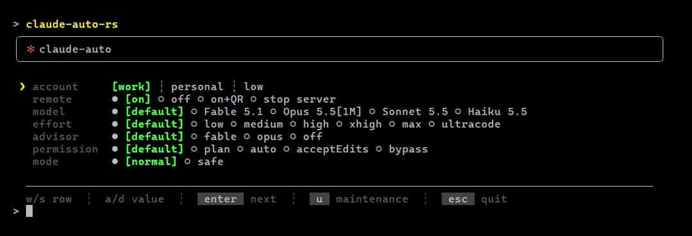

<div align="center">
  
  <sub>Fig 1 · The launch screen of <code>claude-auto-rs</code> in preview mode on the four-account test fixture. Generator: <a href="docs/media/README.md">docs/media</a>.</sub>
  <h3>A Windows launcher for Claude Code: pick the account, model, effort and project, then start the session.</h3>
  <p>
    <a href="https://github.com/vitaliy-shatskiy/claude-auto-launcher/actions/workflows/ci.yml"></a>
    <a href="LICENSE"></a>
    
    
  </p>
  <p><a href="#install">Install</a> · <a href="#the-screens">Screens</a> · <a href="#configuration">Configuration</a> · <a href="#troubleshooting">Troubleshooting</a> · <a href="#development">Development</a></p>
</div>

> [!IMPORTANT]
> Unofficial and unaffiliated with Anthropic. It runs the `claude` CLI you already have. Bugs in the
> CLI itself belong [upstream](https://github.com/anthropics/claude-code/issues).

```
git clone https://github.com/vitaliy-shatskiy/claude-auto-launcher.git
cd claude-auto-launcher
cargo build --release --locked
```

## What it is

A Windows launcher for Claude Code: an account picker, remembered model, effort, advisor and
permission choices per account, a project picker, a session-resume picker and a maintenance screen.
Everything machine-specific lives in one config file. One `.exe` (`claude-auto-rs`), written in
Rust, no runtime.

The bracketed value on each row is what `default` resolves to in the account's own `settings.json`
(`model`, `effortLevel`, `advisorModel`, `permissions.defaultMode`). A key that file does not set
reads `default`. The model names come out of the installed `claude.exe` itself, so they follow the
CLI's releases.

## Requirements

- Windows.
- Claude Code (`claude` on PATH). The launch-screen rows were built against `2.1.263`. A much older
  or newer CLI may accept different flags.
- To build it: Rust through `rustup` with the MSVC host toolchain. `rust-toolchain.toml` pins the
  version (1.99.1) and the `clippy` and `rustfmt` components.
- Node.js or PowerShell 7, only for `.js`/`.mjs` or `.ps1` launch hooks.

## Install

```
cargo build --release --locked
```

The binary is `target\release\claude-auto-rs.exe`. Copy it to a folder on your PATH (or put that
folder on PATH). There is no installer: no config file means one `work` account on `~/.claude`
(see [Configuration](#configuration)).

`claude-auto-rs --launcher-version` prints the launcher's own version and exits.

## The screens

- **Launch screen** - rows for account (a tab strip carrying each account's five-hour usage %),
  model, effort, advisor, permission and mode (`safe` disables CLAUDE.md, skills, plugins, hooks and
  MCP for that session). Each row shows what `default` resolves to for the current account and
  folds the option it equals into that cell. A Claude Code release the channel serves but the
  machine has not downloaded yet is installed before the screen draws. With `remote: true` a Remote
  row appears too. Arrows move and change, `enter` moves on to the project screen, `u` opens
  maintenance, `esc` quits.
- **Project screen** - which directory the session runs in, and what it does there. Row 0 is the
  current directory. Known projects (from `~/.claude/projects`) follow. Scratch directories
  (anything under the temp folder or a profile's `jobs\<id>\tmp`) are left out and counted in the
  title (`10 known ─ 19 hidden`), and a filter that matches one lists it. A typed path row,
  `+ enter a path...`, sits last. Under the list sits an `action` radio row,
  `○ new ○ continue ● [resume] ○ worktree`: left/right (or `a`/`d`) step it, `enter` does what it
  says on the highlighted row. The hotkeys fire straight away: `c` continues, `r` resumes (opens the
  session picker, scoped to that project), `t` starts it in a new git worktree (`-w`). `/` filters,
  `esc` goes back. The action opens at `new` every launch.
- **Session picker** (resume on the project screen) - a list with a last-exchange preview, scoped
  to the chosen project. `/` filters, `enter` opens, `f` forks, `tab` widens to every project and
  back, `esc` returns to the launch screen. Headless sessions (`claude -p`, the SDKs) are left out
  and counted in the title.
- **Maintenance** (`u`) - `u` update, `r` rename swap, `d` doctor, `m` mcp list, `p` prune, plus one
  hotkey per configured `maintenanceActions[]` entry, `esc` back. **Not covered by preview mode**:
  its actions run against your real Claude Code install even during a preview run.
- **The mouse** - moving the pointer highlights what sits under it and moves nothing else. A left
  click selects, and a click on the row that already carries the cursor runs or opens it, as `enter`
  would. A click on an option value sets it, a click on a footer button presses its key. The wheel
  scrolls. `CLAUDE_AUTO_NO_MOUSE=1` turns all of it off.

<details><summary><b>The project screen and the session picker</b> (golden frames <code>project-100x30.txt</code> and <code>picker-100x30.txt</code> from <code>tests/fixtures/wide-frames/</code>, sample data)</summary>

```
╭─ project ─ 4 known ─────────────────────────────────────────────────────────────────────────────╮
│   current directory                                                        C:\Users\sample\here │
│                                                                                                 │
│ ❯ alpha                                             C:\Users\sample\Desktop\Projects\alpha 4 min│
│   beta-service                       C:\Users\sample\Desktop\Projects\workspace\beta-service 8 h│
│   ⌂ gamma                           C:\Users\sample\Desktop\Projects\gamma.worktrees\feature 3 d│
│   delta                                                                        D:\src\delta 23 d│
│                                                                                                 │
│   + enter a path...                                                                             │
│   action  ● [new] ○ continue ○ resume ○ worktree                                                │
╰─────────────────────────────────────────────────────────────────────────────────────────────────╯
  w/s move  ┊  a/d action  ┊  [enter] run  ┊  [c] continue  ┊  [r] resume  ┊  [t] worktree
  [/] filter  ┊  [esc] back

╭─ resume ─ 5 sessions ───────────────────────────────────────────────────────────────────────────╮
│   project-1  snippet 1 about t… 7 min │ project-2                                               │
│ ❯ project-2  snippet 2 about … 14 min │ 16 Sep 11:46  ─  6 msgs  ─  4 KB                        │
│   ⌂ feature  snippet 3 about … 21 min │ ─────────────────────────────────────────────────────── │
│   project-4  snippet 4 about … 28 min │ you › snippet 2 about the thing that was asked          │
│   project-5  snippet 5 about … 35 min │ claude › reply words reply words reply words reply      │
│                                       │          words reply words reply words reply words      │
│                                       │          reply words                                    │
╰─────────────────────────────────────────────────────────────────────────────────────────────────╯
  w/s move  ┊  [/] filter  ┊  [enter] open  ┊  [f] fork  ┊  [esc] back
```
</details>

## Usage

Every argument is passed through to `claude` untouched: `claude-auto --model opus "fix the build"`
shows the screens, then runs `claude` with those arguments added. The one exception is
`--launcher-version` alone. `--version` belongs to the CLI.

<details><summary><b>Environment switches</b></summary>

| Variable | Effect |
|---|---|
| `CLAUDE_AUTO_CONFIG` | path to the config file, instead of `~/.claude/claude-auto.json` |
| `CLAUDE_AUTO_PREFS` | path to the remembered-choices file, instead of `~/.claude/claude-auto-prefs.json` |
| `CLAUDE_AUTO_NO_MOUSE=1` | never arms mouse input |
| `CLAUDE_AUTO_NO_UPDATE=1` | skips the release-channel check and the update it would run before the launch screen |
| `CLAUDE_AUTO_INPUT_TRACE=1` | logs every raw input record to `~/.claude/claude-auto-logs/input-<date>-<pid>.log` |
| `CLAUDE_AUTO_ASCII=1` | forces ASCII box drawing (otherwise auto-detected from the console code page) |
| `CLAUDE_AUTO_PREVIEW=1` | drives the whole UI and prints the `claude` command it would run, without running it. The maintenance screen is the one exception |
| `CLAUDE_AUTO_PREVIEW_KEYS` | a key script for a preview run, e.g. `Enter,r,Enter` |
| `CLAUDE_AUTO_PREVIEW_SIZE` | the preview's terminal size, e.g. `100x30` (default `78x24`) |
| `CLAUDE_AUTO_PROJECTS_ROOT` | the projects directory the project screen and the picker read, instead of `~/.claude/projects` (a test seam) |
| `CLAUDE_AUTO_RATE_LIMITS_DIR` | where the usage records are read, instead of `~/.claude/rate-limits` (a test seam) |
| `CLAUDE_NO_ROAM=1` | never routes a session through the companion server, even with `remote: true` |
| `CLAUDE_REMOTE_ROOT` | path to the (unpublished) `remote-control-claude-code` checkout |
| `CLAUDE_AUTO_MIRROR_EXCLUDE`, `CLAUDE_AUTO_MIRROR_SECRETS=0` | the MCP mirror's exclude list and credential opt-out (see [Multi-account sharing](#multi-account-sharing)) |
| `NO_COLOR`, `TERM=dumb` | disable colour output |

The session the launcher starts carries `CLAUDE_AUTO_LAUNCHED=1`, so a SessionStart hook can tell a
launcher start from one by hand.

</details>

### Preview mode

Preview mode drives the UI from a key script and prints the command it would run. Nothing is
launched, and no real Claude is needed. Point every file it reads at throwaway copies:

```powershell
$t = Join-Path $env:TEMP 'claude-auto-demo'
New-Item -ItemType Directory -Force (Join-Path $t '.claude') | Out-Null
$env:USERPROFILE = $t
$env:CLAUDE_AUTO_PREFS = Join-Path $t 'prefs.json'
$env:CLAUDE_AUTO_PROJECTS_ROOT = Join-Path $t 'projects'
$env:CLAUDE_AUTO_CONFIG = (Resolve-Path tests\fixtures\config-four.json).Path
$env:CLAUDE_AUTO_PREVIEW = '1'
$env:CLAUDE_AUTO_PREVIEW_KEYS = 'Enter,Enter'
$env:CLAUDE_AUTO_PREVIEW_SIZE = '100x30'
$env:NO_COLOR = '1'
.\target\release\claude-auto-rs.exe
```

It prints each frame, then a summary ending in `--- preview, nothing launched ---` with the launch
arguments and the command line.

### Debug mode

`claude-auto-rs --launcher-debug` (the only argument, like
`--launcher-version`) or `CLAUDE_AUTO_DEBUG=1` times each step of the run. `--debug` stays
claude's own flag and passes through.

- Nothing changes on screen. `CLAUDE_AUTO_DEBUG=footer` adds one dim bottom line:
  `load <n> ms · paint <n> ms · last key->frame <n> ms` (the screen's data load, its first paint,
  the last key to its frame). The screen then draws one row shorter, so nothing is covered.
- F12 opens the timings of this run as a tree, slowest first within each level. Esc goes back.
- Each span lands in the run log as a `timing` record (`name`, `parent`, `ms`, `startMs`).
- `claude-auto-rs --launcher-timings [--days N]` prints count, p50, p95 and max per span name from the logs
  of today (or the last `N` days), then exits.

Off, nothing changes and nothing extra is read or written.

## Configuration

`~/.claude/claude-auto.json` (or `CLAUDE_AUTO_CONFIG`). No file = one account, `work` ->
`~/.claude`, sharing and remote off. Every validation failure falls back to the default for that key
and prints a warning at launch. Nothing throws. An unrecognised top-level key (a typo, e.g.
`account` for `accounts`) also warns, naming it. Windows path values must use `~/...` or forward
slashes, or double every backslash (`C:\\Users\\me\\.claude`): JSON reads a single backslash as an
escape character, and an unescaped one fails the whole file.

See `config.example.json` for a two-account example (sharing off, `launchHooks` and
`maintenanceActions` empty). Example values: `"launchHooks": ["~/scripts/after-launch.ps1"]`,
`"maintenanceActions": [{ "key": "i", "label": "reindex", "script": "~/scripts/reindex.ps1", "confirmTwice": true }]`.

<details><summary><b>All config keys</b></summary>

| key | type | default | notes |
|---|---|---|---|
| `accounts[]` | `{key, root, label, tint, hidden, archived}` | one `work` account | key 1-8 chars, unique (a shared first letter is fine: the no-UI prompt advertises the shortest unique prefix). root absolute, exactly one must resolve to `~/.claude` (the canonical account). tint one of Green/Magenta/Cyan/Blue/Yellow/Red. hidden omits it from the tab strip and the no-UI prompt's text, though it stays typeable there. archived makes the launcher ignore it entirely (no tab, no prompt entry, no relink or junction, no limits, not restored from prefs) and is refused with a warning on the canonical account, while its key still counts for uniqueness. Breaking any one of these rules discards the WHOLE roster: the warning names the culprit and its value, and every account falls back to the single default `work` account |
| `sharing` | bool | `false` | forced off with fewer than two accounts. Read [Multi-account sharing](#multi-account-sharing) before turning it on |
| `remote` | bool | `false` | **the companion it needs is not published**: `crc.cmd` on PATH plus a `remote-control-claude-code` checkout (`CLAUDE_REMOTE_ROOT`). Leave it off unless you have written your own. Adds a Remote row to the launch screen and a second prompt in the no-UI fallback |
| `riderMcp` | `auto`\|`on`\|`off` | `auto` | `auto` scans for Rider's MCP port only while Rider is running |
| `extraMcpConfigs[]` | paths | `["~/.claude/mcp-shared.json"]` | must be absolute. A relative entry is skipped with a warning |
| `secretsRoot` | path | `~/.claude-secrets` | must be absolute. See [Secrets](#secrets) |
| `launchHooks[]` | paths | `[]` | `.ps1`/`.js`/`.mjs`/`.cmd`, run after the account choice with the chosen project as the working directory, each best-effort. Must be absolute |
| `maintenanceActions[]` | `{key, label, script, confirmTwice}` | `[]` | key is one character, a-z or 0-9, outside `u r d m p`. `script` is required and must be absolute. An entry failing either check is skipped with a warning |

</details>

### Secrets

`secretsRoot` is a directory of per-project subdirectories whose FILES become environment variables
of the launched session (file name = variable name, content = value), so a token never sits in a
config file. `.md` files and empty files are skipped. Three tiers apply in order, each later one
overriding the earlier: `shared/`, `<slug>/org/` (opted in with a junction, never automatic), then
`<slug>/` for the chosen project.

<details><summary><b>Files it writes</b></summary>

- `~/.claude/claude-auto-prefs.json` - remembered account, model, effort, advisor, permission and
  remote choices.
- `~/.claude/launcher-logs/*.jsonl` - one file per day, 14-day retention. Records each launch: the
  working directory, the launcher's own argument vector, the launcher version (`psVersion`, which
  reads `rust <version>`), the terminal it came out of, and the choices made.
  **A prompt passed positionally (`claude-auto "fix the build"`) lands there in plain text.** Local
  only, nothing is sent anywhere.
- `~/.claude/claude-auto-hash-cache.json` - the maintenance screen's version-check cache.
- `~/.claude/claude-auto-models.json` - the model catalog read out of `claude.exe`, keyed on the
  binary's path, size and mtime.
- `~/.claude/claude-auto-update.json` - the release channel's last answer (30 minutes, a failure 5).
- `~/.claude/claude-auto-projects.json` - the project screen's registry cache.
- `~/.claude/claude-auto-rs-sessions.json` - the session picker's summary cache (one file, every
  account reads the same session list).
- `%TEMP%\claude-mcp-rider-<pid>.json` - per-launch Rider MCP config, swept after a day.
- `%TEMP%\claude-rider-mcp-port.txt` - cached Rider MCP port, so most launches skip the port scan.
- `%TEMP%\claude-remote-server-<pid>.log` (plus `.err`, `.build`) - the companion server's output,
  one set per launcher that started it (`remote: true` only), not swept.
- `<file>.pre-relink`, and `<file>.pre-relink.<yyyyMMdd-HHmmss>` for the three before it, beside a
  shared file a sharing repair just replaced (see [Multi-account sharing](#multi-account-sharing)).

The launch screen's usage bars need a `~/.claude/rate-limits/<key>.json` writer. Nothing in this
repo writes that file.

</details>

## Multi-account sharing

`sharing: true` (two or more accounts, OFF in `config.example.json` on purpose) hardlinks
`settings.json` and `statusline.js`, symlinks `CLAUDE.md` (a hardlink would load it twice under the
home tree, and a copy equal to the canonical one is replaced, saved as
`CLAUDE.md.pre-symlink.<yyyyMMdd-HHmmss>`), and junctions `projects`, `plugins`, `hooks`, `agents`,
`skills`, `rules`, `sessions`, `file-history`, `session-env`, `tasks` and `shell-snapshots` from
every secondary account's root back to the canonical (`~/.claude`) one, repaired on every launch.

Before you turn it on:

- The repair links from whichever copy is NEWEST anywhere, so a newer secondary copy can REPLACE the
  canonical one. The losing copy survives as `<file>.pre-relink`, an earlier one as
  `<file>.pre-relink.<yyyyMMdd-HHmmss>`, the newest three kept and older ones deleted.
- Enabling it CREATES every secondary account's root directory on the next launch.
- Each junction it creates gets two `icacls` deny ACEs, so removing one later needs
  `icacls <path> /L /remove:d "<user>"` before a plain delete works.

The MCP mirror that `sharing` runs copies user- and project-scoped server definitions from the
canonical account into the others verbatim, secrets included: a server's `env` and `headers` fields,
where it keeps its token, land in every account's `.claude.json`. That is the default because the
accounts are one person's on one machine. The canonical definition wins in both scopes: a missing
server is added, one defined differently is replaced, a server only the target has is kept.
`CLAUDE_AUTO_MIRROR_SECRETS=0` compares and copies servers without those two fields and keeps the
target's own ones. `CLAUDE_AUTO_MIRROR_EXCLUDE=name1,name2` never touches those servers. The
mirror is built into the launcher: no Node needed.

## Troubleshooting

**`claude-auto-rs` is not recognised.** A PATH change reaches only a *new* terminal. Open one.

**The maintenance screen says an update succeeded and the version did not change.** On Windows
`claude update` can report success while the running binary is untouched, usually a file lock on the
in-use executable. That is what `r` (rename swap) is for: it renames the running binary aside and
installs the new build in its place.

**The whole roster collapsed to one `work` account.** Any single invalid account discards the entire
roster by design. The warning at launch names the culprit and its value. The usual cause is a
Windows path in JSON: `"C:\Users\me\.claude"` is invalid JSON escaping. Write `~/...`, forward
slashes, or `C:\\Users\\me\\.claude`.

**The box drawing is mojibake.** Set `CLAUDE_AUTO_ASCII=1`, or switch the console to UTF-8.

**Arrows or the mouse behave oddly in an embedded terminal.** Some terminals (Rider's, for one) send
mouse reports as VT text rather than as console records. The launcher decodes them, but if it goes
wrong, `CLAUDE_AUTO_NO_MOUSE=1` disables mouse input and `CLAUDE_AUTO_INPUT_TRACE=1` logs every raw
input record for a bug report.

**A preview run ends with `claude-auto: scripted keys exhausted` and exit 1.** The key script in
`CLAUDE_AUTO_PREVIEW_KEYS` ran out before a launch or a quit. Add the missing keys.

## Uninstall

Nothing is installed outside your own user profile, and there is no uninstaller.

1. Delete `claude-auto-rs.exe` from the folder you copied it to, or remove the folder you added to
   PATH: `sysdm.cpl` -> Advanced -> Environment Variables -> user `Path`.
2. Delete the clone.
3. Optional, to remove the state too: the `claude-auto-*.json` files, `launcher-logs/` and
   `claude-auto-logs/` under `~/.claude` (full list under **Files it writes**).
4. **Only if you ever set `sharing: true`**: the junctions it created under each secondary account
   root carry two `icacls` deny ACEs, so a plain delete fails. Lift them first with
   `icacls <path> /L /remove:d "<user>"`, then remove the junction.

## Development

```
cargo build --release --locked
cargo test --locked
cargo fmt --all --check
cargo clippy --all-targets --locked -- -D warnings
```

- The toolchain is pinned in `rust-toolchain.toml` (1.99.1, with `clippy` and `rustfmt`), edition
  2024. One package: a library (`src/lib.rs`) and the binary (`src/main.rs`).
- Lints live in `Cargo.toml` `[lints]`: clippy pedantic, `unwrap`/`expect` denied, `unsafe_code`
  denied outside the FFI modules. A local override is `#[expect(lint, reason = "...")]` on the
  smallest item, never `#[allow]`.
- Unit tests sit beside the code (`src/<module>/tests.rs`), and the screen tests compare frames
  against the golden files in `tests/fixtures/wide-frames/`. `tests/it/` runs the built binary end to
  end against a fake home and a fake `claude`: preview frames, argument pass-through, the launch
  marker, `--mcp-config` placement and `--launcher-version`.
- `tests\check-clean.ps1` is the privacy scan: it greps the git-tracked worktree for the current
  Windows username plus an optional private pattern list (`CLAUDE_AUTO_CLEAN_PATTERNS`, one regex per
  line). It never reads commit history or authorship.
- The launcher began as a PowerShell script and was ported to Rust: [PORTING.md](PORTING.md).

**CI** (`.github/workflows/ci.yml`, a Windows runner) runs the gates (`fmt --check`,
`clippy -D warnings`, `test`, all `--locked`). The privacy scan needs a private pattern list, so CI
does not run it.

## Contributing, security, licence

- [CONTRIBUTING.md](CONTRIBUTING.md) - the gates and what a PR needs.
- [SECURITY.md](SECURITY.md) - what this touches on your machine, and how to report a hole privately.
- [CHANGELOG.md](CHANGELOG.md).
- [MIT](LICENSE).
